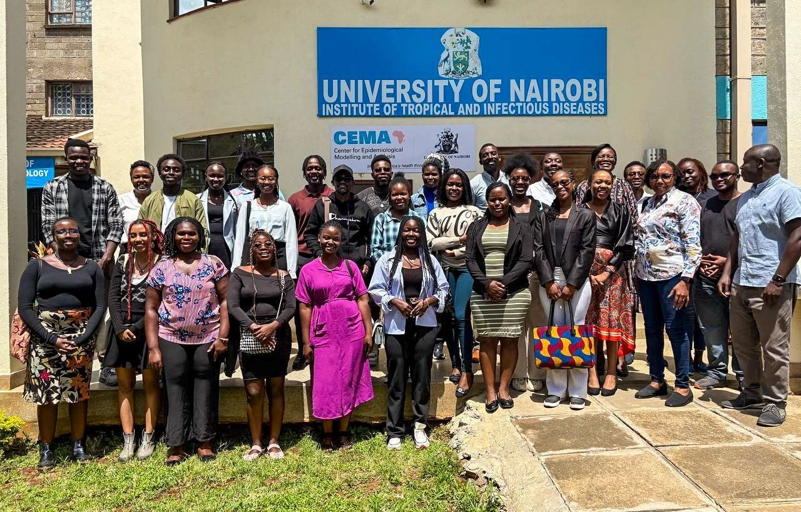

::: {.activity-list}

::: {.activity .linked}
[<i class="bi bi-mic"></i>]{.activity-icon}

::: {.activity-body}
[Conference · Delegate]{.tag}

### Africa Health Tech Summit 2026

[Kigali, Rwanda · 30 Sep – 2 Oct 2026]{.activity-when}

I attended as a **delegate**, focusing on workshops about **early warning systems**. These included a panel on combining vitals and voice to detect neonatal sepsis earlier, which broadened into public health intelligence with WHO AFRO.

[Read about the summit →](activities/africa-health-tech-summit-2026.qmd){.activity-link .stretched-link}
:::

{.activity-thumb fig-alt="Panellists on stage at the Africa HealthTech Summit neonatal mortality breakout."}
:::

::: {.activity .linked}
[<i class="bi bi-people"></i>]{.activity-icon}

::: {.activity-body}
[Gathering · Panellist]{.tag}

### AL for Health Network Gathering

[African Leadership Academy · Kigali, Rwanda · 29 Sep 2026]{.activity-when}

I spoke on the panel **"The Future of Healthcare in Africa: Beyond the Hype"**, covering prevention, modelling for early detection, targeted financing and equity. I also took part in a rapid-design Community Lab.

[Read about the gathering →](activities/al-for-health-gathering-2026.qmd){.activity-link .stretched-link}
:::

{.activity-thumb fig-alt="Ronald speaking on a panel at the AL for Health Network Gathering in Kigali."}
:::

::: {.activity .linked}
[<i class="bi bi-diagram-3"></i>]{.activity-icon}

::: {.activity-body}
[Institutional visit]{.tag}

### Center for Epidemiological Modelling and Analysis (CEMA)

[University of Nairobi · Nairobi, Kenya · 19 May 2025]{.activity-when}

At the end of my junior year, our Epidemiology and Biostatistics cohort visited CEMA for an information session on how epidemiological modelling and health data analysis shape public health policy, and the careers behind that work.

[Read about the visit →](activities/cema-visit-2025.qmd){.activity-link .stretched-link}
:::

{.activity-thumb fig-alt="USIU-Africa students with the CEMA team outside the University of Nairobi Institute of Tropical and Infectious Diseases."}
:::

:::
