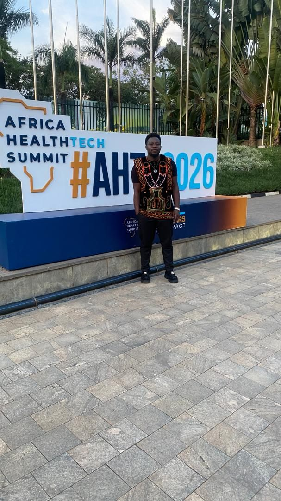
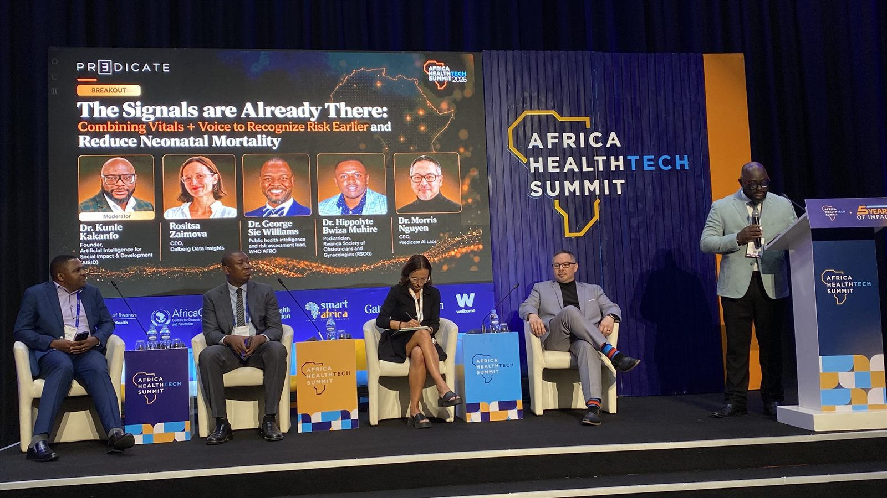
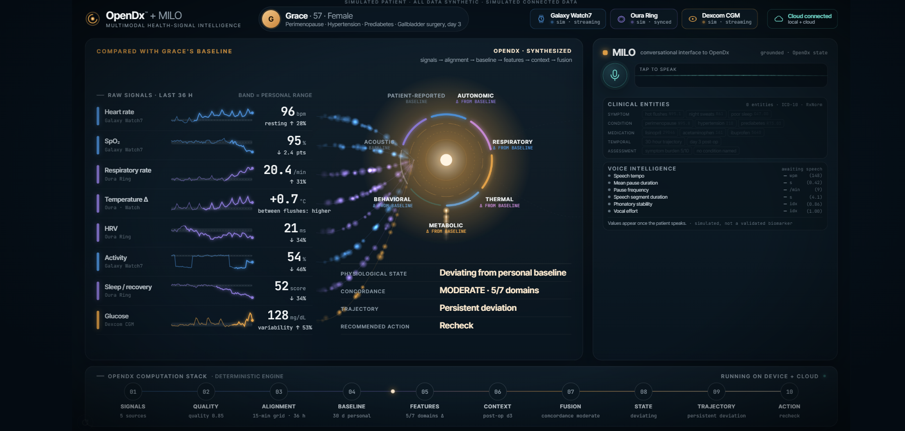
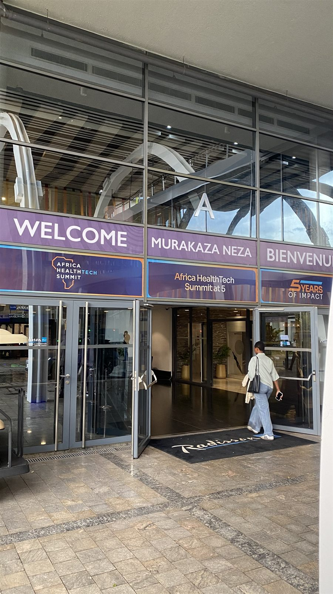
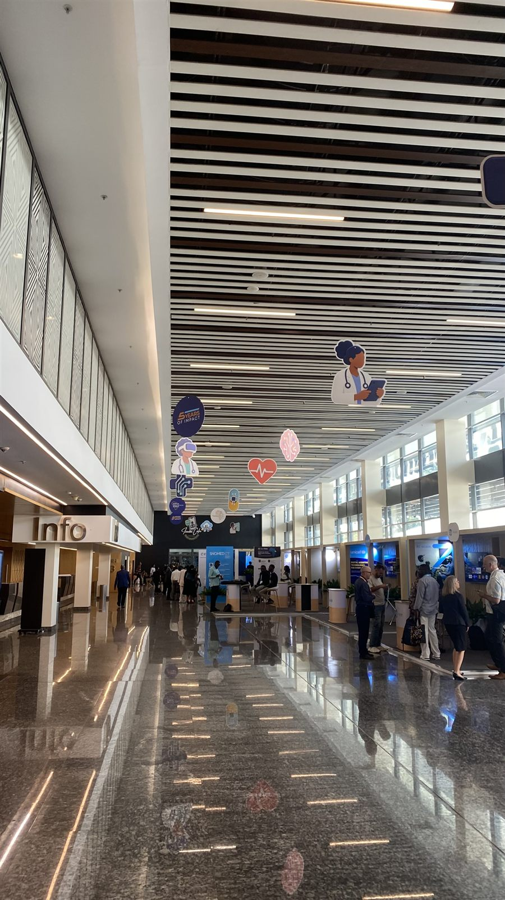
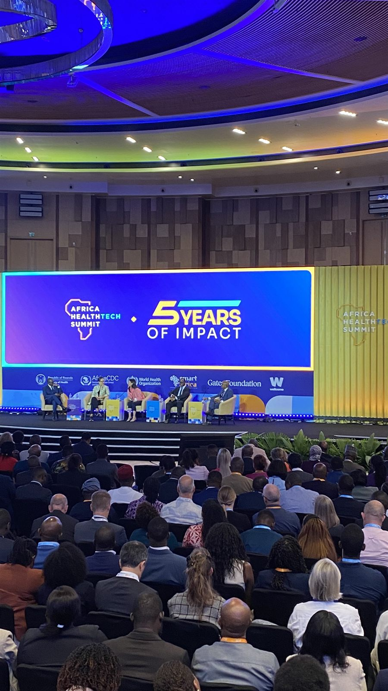
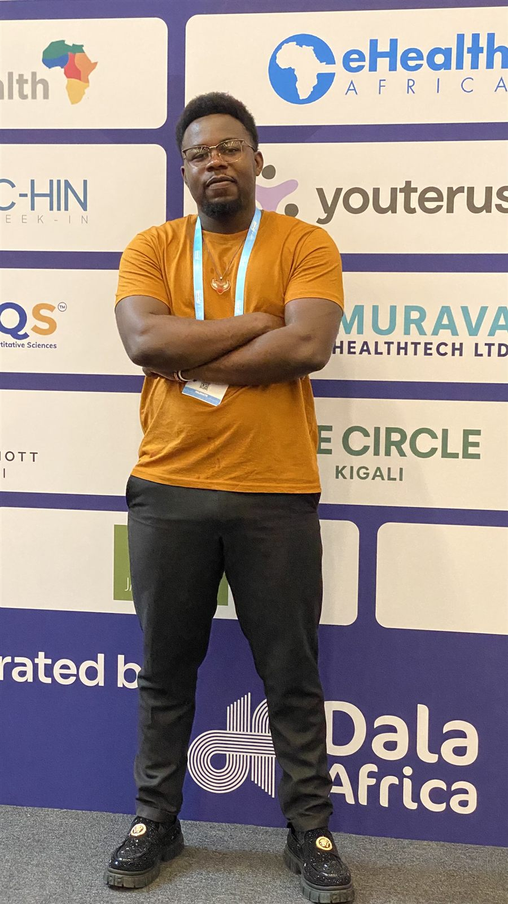
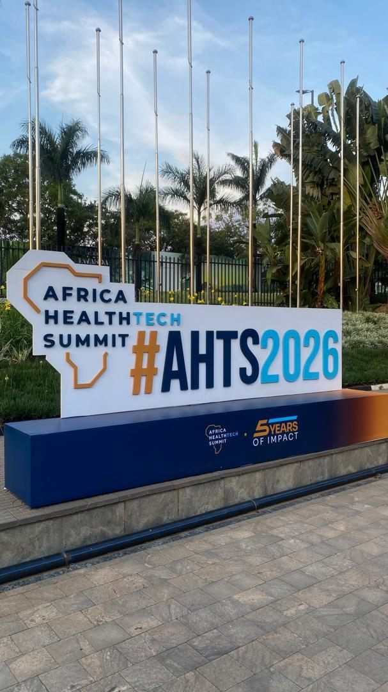

[← All activities](../activities.qmd){.back-link}

::: {.project-meta}
::: {}
[Role]{.k}
[Delegate]{.v}
:::
::: {}
[Location]{.k}
[Kigali, Rwanda]{.v}
:::
::: {}
[Dates]{.k}
[30 Sep – 2 Oct 2026]{.v}
:::
::: {}
[Focus]{.k}
[Early warning systems]{.v}
:::
:::

::: {layout="[58,42]" layout-valign="center"}
::: {}
In 2026 the Africa Health Tech Summit marked **five years of impact**, bringing innovators, health ministries, researchers and funders to Kigali to discuss technology for African health systems.

I attended as a **delegate** and concentrated on workshops about **early warning systems**: using technology to spot risk before it becomes a crisis, from individual patients to whole populations.
:::

{.photo fig-alt="Ronald, wearing a black and red embroidered top, stands in front of the large Africa HealthTech Summit #AHTS2026 sign outside the venue."}
:::

## Early detection of neonatal sepsis

{.photo fig-alt="Five panellists seated on stage beneath a large screen showing the session title and speaker photos; a moderator speaks from a podium on the right."}

The first workshop I attended was a panel on **early detection to reduce neonatal mortality**, focusing on **sepsis**. It asked how continuous vital signs and voice signals could flag deteriorating newborns earlier than routine clinical observation.

The panel included the **WHO AFRO lead for public health intelligence and risk assessment**, so the discussion moved beyond the bedside. It covered how the same early-warning logic applies to **population-level surveillance**: detecting signals, comparing them with a baseline, and acting before an outbreak grows.

## Innovations on show

{.photo fig-alt="A dark dashboard showing eight wearable signal traces (heart rate, SpO2, respiratory rate, temperature, HRV, activity, sleep, glucose) feeding a radial fusion diagram, with a summary reading 'Deviating from personal baseline', 'Persistent deviation' and 'Recheck', and a ten-step computation pipeline along the bottom."}

Systems like this one fuse many signal streams into one state estimate. Each signal is compared with a **personal baseline**, deviations are tracked over time, and the system recommends an action.

## What I took away

These innovations made me think about bringing **more technology into the mathematical frameworks** I already use. Baselines, deviation and trajectory are the core of the interrupted time-series and Bayesian models in my own research. Continuous, multimodal data streams could make those models faster and more sensitive, both for individual patients and for surveillance systems that catch outbreaks and hidden deaths early.

## Around the summit

::: {.gallery layout="[[1,1,1],[1,1,-1]]"}
{.photo fig-alt="The glass entrance of the summit venue with banners reading Welcome, Murakaza Neza and Bienvenue, and Africa HealthTech Summit at 5."}

{.photo fig-alt="A long, bright exhibition hall with a polished floor, health-themed decorations hanging from the ceiling, and delegates talking at exhibitor booths."}

{.photo fig-alt="A large auditorium full of delegates facing a stage where five panellists sit beneath a screen reading Africa HealthTech Summit, 5 Years of Impact."}

{.photo fig-alt="Ronald, in an orange t-shirt and delegate lanyard, stands with arms crossed in front of a wall of sponsor logos."}

{.photo fig-alt="The Africa HealthTech Summit #AHTS2026 sign in a garden with palm trees and flagpoles."}
:::

::: {.project-links}
[<i class="bi bi-globe"></i> Africa Health Tech Summit website](https://healthtechsummit.africa/){.btn .btn-outline-primary}
:::

::: {.next-project}
Next: [Visit to CEMA →](cema-visit-2025.qmd)
:::
