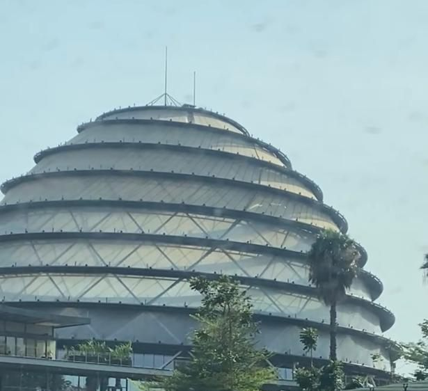
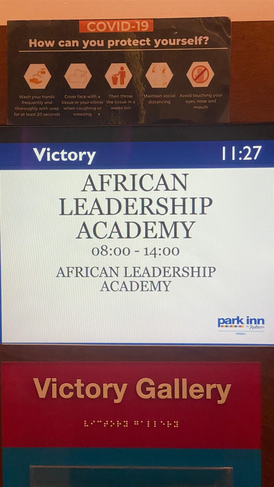
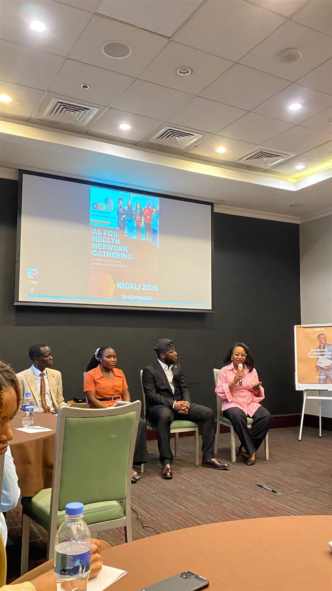
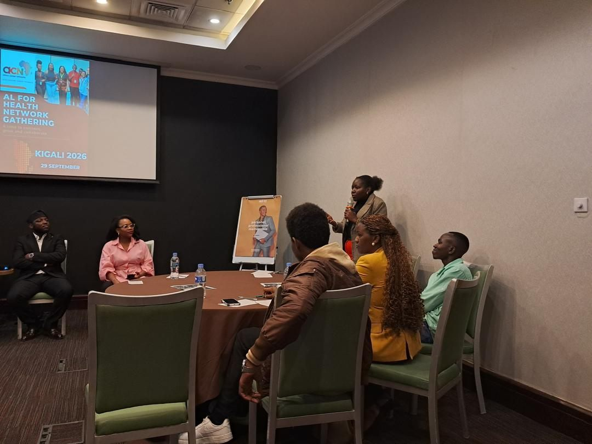
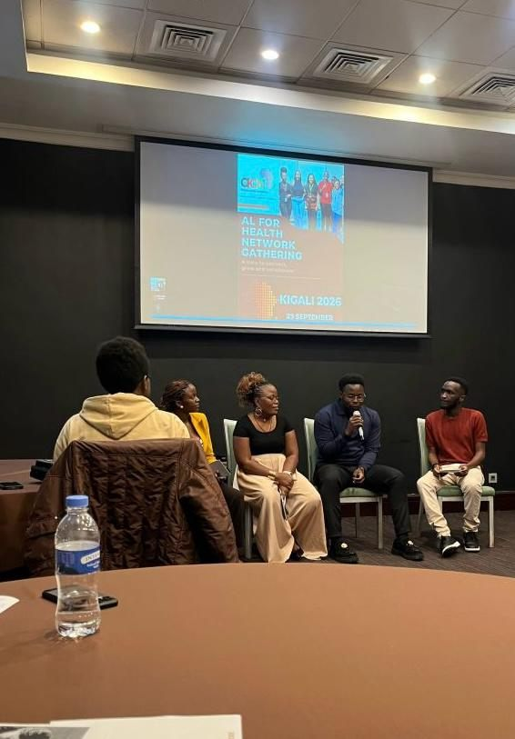
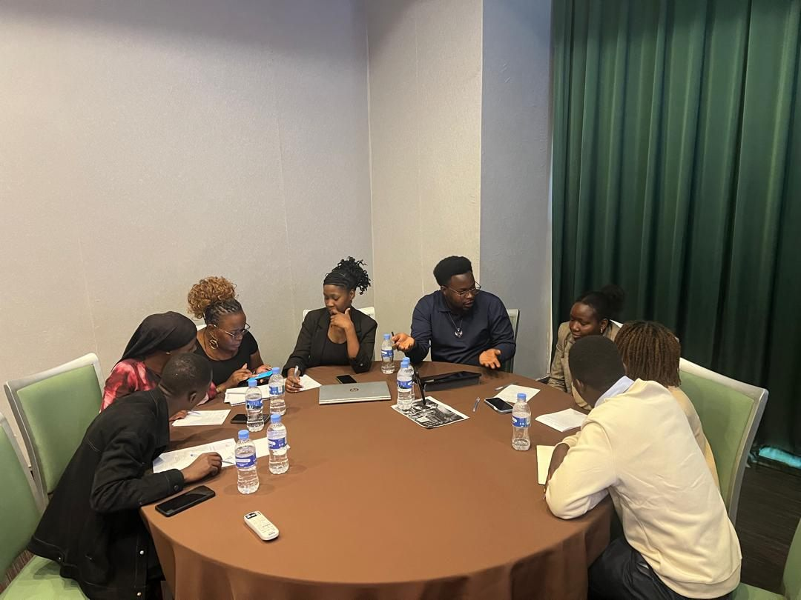
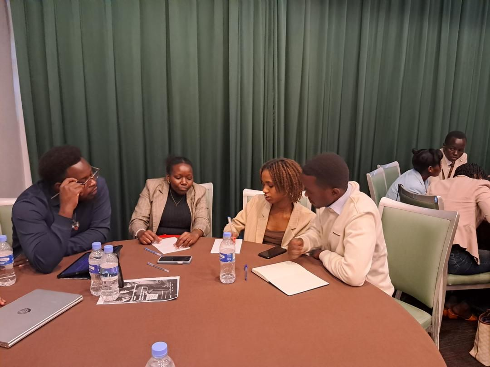

[← All activities](../activities.qmd){.back-link}

::: {.project-meta}
::: {}
[Role]{.k}
[Panellist]{.v}
:::
::: {}
[Host]{.k}
[African Leadership Academy · Africa Career Networks]{.v}
:::
::: {}
[Location]{.k}
[Kigali, Rwanda]{.v}
:::
::: {}
[Date]{.k}
[29 Sep 2026]{.v}
:::
:::

> "The gathering is designed to move beyond conventional networking by creating a space for honest conversations, peer learning, and meaningful connections around the future of healthcare and health technology in Africa."

The AL for Health network met in Kigali the day before the [Africa Health Tech Summit](africa-health-tech-summit-2026.qmd). The programme had two panel sessions and an interactive Community Lab. I spoke on the second panel.

::: {.gallery layout-ncol=2}
{.photo fig-alt="The domed, ribbed Kigali Convention Centre building against a pale blue sky, with palm trees in front."}

{.photo fig-alt="A digital room sign outside the Victory Gallery reading African Leadership Academy, 08:00 to 14:00, Park Inn Kigali."}
:::

## Panel 1: Building a career in health & technology

**"Building a Career at the Intersection of Health & Technology"** covered career pathways, emerging opportunities, skills and lessons from across the ecosystem. Three innovators who are building health-tech products shared how they got there and what they have learned, and then the audience joined in with questions.

::: {.gallery layout-ncol=2}
{.photo fig-alt="Four panellists seated beneath a screen reading AL for Health Network Gathering, Kigali 2026, 29 September; a woman in pink speaks into a microphone."}

{.photo fig-alt="A participant stands and asks a question with a microphone while panellists and other participants listen around a table."}
:::

## Panel 2: The future of healthcare in Africa

::: {layout="[58,42]" layout-valign="center"}
::: {}
**"The Future of Healthcare in Africa: Beyond the Hype"** looked at digital health, connected care, prevention, financing, equity, and what it takes to turn innovation into impact.

I was one of the panellists and spoke mainly on **prevention**. Africa faces many health challenges at once, and **early detection** is a recurring gap. My argument was that **modelling** lets us see problems coming, provided we are honest about its limits.
:::

{.photo fig-alt="Ronald, holding a microphone, speaks while seated among four other panellists beneath a screen reading AL for Health Network Gathering, Kigali 2026."}
:::

### What I spoke about

::: {.card-grid}
::: {.pcard}
[Prevention]{.tag}

#### Modelling to foresee, not just react

Models can flag where and when disease burden is likely to rise, so prevention can act before cases appear at the clinic.
:::

::: {.pcard}
[The caveat]{.tag}

#### Data quality and access

The usual obstacles to modelling are poor data quality and limited access to data. Neither can be ignored if models are to be trusted.
:::

::: {.pcard}
[Financing]{.tag}

#### Targeting prevention spending

We should model which populations currently receive intensified prevention and compare them with the populations at greatest risk, so that limited health budgets go where they matter most.
:::

::: {.pcard}
[Equity]{.tag}

#### Making disparities visible

Analysis should reveal disparities between population sub-groups, so that the groups being left behind get attention and resources.
:::
:::

All four points come together through **technology**. AI and advanced methods such as the **Super Learner** ensemble algorithm can strengthen each of them and help move healthcare in Africa to the next level.

## Community Lab

**"From Shared Challenges to Collective Possibilities"** was an interactive session in which participants worked together on real healthcare challenges and looked for opportunities to collaborate.

We were split into **four random teams**. Each team identified a problem and designed a **multidisciplinary approach** to address it, with **15 minutes** to think, design and finalise the idea and **2 minutes** to pitch it. The exercise was fun and tested how quickly we could innovate under pressure. Our team was able to continue building this idea more deeply for a potential submission to the upcoming **AL for Health Co-Creation Labs**.

::: {layout-ncol=2}
{.photo fig-alt="Eight participants around a round table with notes, a laptop and water bottles; Ronald gestures while explaining an idea."}

{.photo fig-alt="Four participants lean in over a table with notebooks and a printed handout, discussing; another team works in the background."}
:::

::: {.next-project}
Next: [Africa Health Tech Summit 2026 →](africa-health-tech-summit-2026.qmd)
:::
