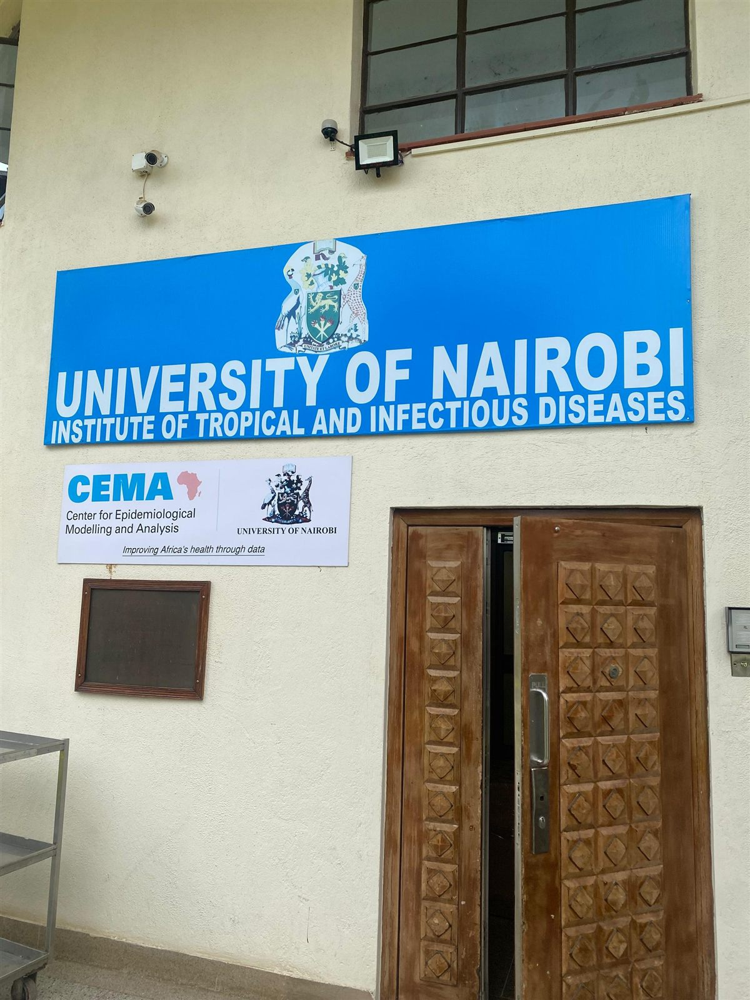
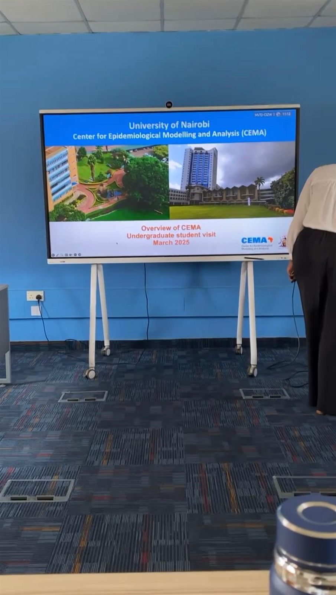
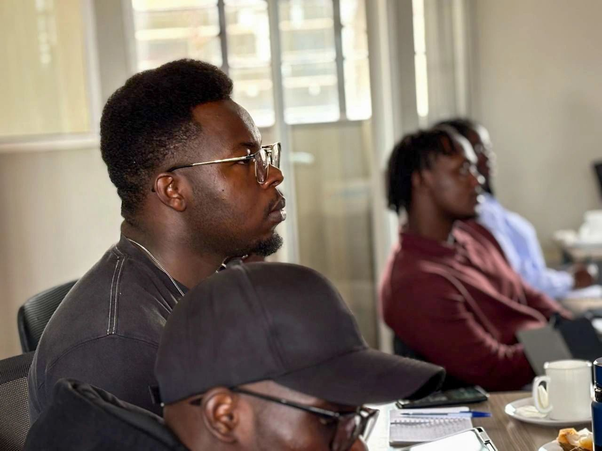

[← All activities](../activities.qmd){.back-link}

::: {.project-meta}
::: {}
[Type]{.k}
[Undergraduate student visit]{.v}
:::
::: {}
[Host]{.k}
[CEMA, University of Nairobi]{.v}
:::
::: {}
[Location]{.k}
[Nairobi, Kenya]{.v}
:::
::: {}
[Date]{.k}
[19 May 2025]{.v}
:::
:::

At the end of my junior year, our cohort of **Epidemiology and Biostatistics students from USIU-Africa** visited the **Center for Epidemiological Modelling and Analysis (CEMA)**, based at the University of Nairobi's Institute of Tropical and Infectious Diseases.

{.photo fig-alt="A large group of students and CEMA staff standing in front of the University of Nairobi Institute of Tropical and Infectious Diseases building, beneath the CEMA sign."}

## In CEMA's words

> "Today, we had the pleasure of hosting Epidemiology and Biostatistics undergraduate students from United States International University - Africa at Center for Epidemiological Modelling and Analysis (CEMA-Africa) for an information session. We provided them an understanding of how epidemiological research and data-driven insights are shaping public health interventions.
>
> Through engaging discussions and a vibrant Q&A session, the students explored potential career paths in epidemiological modeling and health data analysis to inform public health policies."
>
> [CEMA-Africa on LinkedIn](https://lnkd.in/p/dhwupZnU)

For me, it was an early look at epidemiological modelling as a career path.

::: {.gallery layout-ncol=3}
{.photo fig-alt="The entrance to the University of Nairobi Institute of Tropical and Infectious Diseases, with a CEMA sign reading Improving Africa's health through data beside a carved wooden door."}

{.photo fig-alt="A large screen on a stand showing a slide titled University of Nairobi, Center for Epidemiological Modelling and Analysis, Overview of CEMA, Undergraduate student visit."}

{.photo fig-alt="Ronald, in profile and wearing glasses, listens attentively at a meeting table alongside other students."}
:::

::: {.project-links}
[<i class="bi bi-linkedin"></i> CEMA's post about the visit](https://lnkd.in/p/dhwupZnU){.btn .btn-outline-primary}
[<i class="bi bi-globe"></i> CEMA website](https://cema-africa.uonbi.ac.ke/){.btn .btn-outline-primary}
:::

::: {.next-project}
Next: [AL for Health Network Gathering 2026 →](al-for-health-gathering-2026.qmd)
:::
