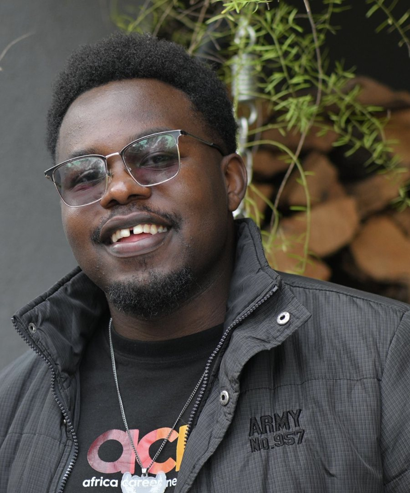

::: {.hero}
::: {.hero-grid}
::: {.hero-text}
[Epidemiology · Biostatistics · Global Health]{.eyebrow}

# [Ronald Parfait]{.name-line} [Kamaha Kamaha]{.name-line} {.hero-name .unnumbered .unlisted}

[I use surveillance data, Bayesian models and spatial analysis to show where disease burden is hidden and work with communities to close those gaps.]{.lede}

::: {.actions}
[View research](research.qmd){.btn .btn-primary}
[Experience](about.qmd){.btn .btn-outline-primary}
[Get in touch](mailto:ronaldkamaha2@gmail.com){.btn .btn-outline-secondary}
:::
:::

::: {.hero-photo}
{fig-alt="Portrait of Ronald Parfait Kamaha Kamaha, smiling, wearing glasses and a dark jacket."}
:::
:::
:::

## Focus areas {.section-label}

::: {.focus-grid}
::: {.focus-card}
[<i class="bi bi-heart-pulse"></i>]{.focus-icon}

### Maternal health

Estimating maternal deaths that routine reporting misses, both nationally and in Nairobi's informal settlements.

::: {.focus-links}
[Maternal mortality in Kenya, 2018–2025](projects/maternal-mortality-kenya.qmd)
[Hidden maternal deaths in Nairobi](projects/nairobi-maternal-mortality.qmd)
:::
:::

::: {.focus-card}
[<i class="bi bi-geo-alt"></i>]{.focus-icon}

### Bayesian & spatial modelling

Hierarchical count models, interrupted time series and GIS for messy, sparse and spatially uneven health data.

::: {.focus-links}
[Conflict and malaria in Cameroon](projects/malaria-conflict-cameroon.qmd)
[Bayesian ZINB for undercounted deaths](projects/nairobi-maternal-mortality.qmd)
:::
:::

::: {.focus-card}
[<i class="bi bi-activity"></i>]{.focus-icon}

### Surveillance & outbreaks

Field epidemiology with Kenya's national public health institute and a referral hospital, from case definitions to contact tracing.

::: {.focus-links}
[Field attachment: KUTRRH & KNPHI](projects/surveillance-kenya.qmd)
[Diagnostic baseline for Batoukop](projects/batoukop-diagnostics.qmd)
:::
:::
:::

## About {.section-label}

I am a BSc Epidemiology and Biostatistics graduate (*Cum Laude*) from **USIU-Africa** in Nairobi and a **Mastercard Foundation Scholar**. I have worked with the **Kenya National Public Health Institute** and **Kenyatta University Teaching, Referral and Research Hospital** on disease surveillance and outbreak response, including Visceral Leishmaniasis, Mpox and school-based outbreaks.

My current research track focuses on what routine data misses: unrecorded maternal deaths in Nairobi's informal settlements, the effect of armed conflict on malaria exposure in Cameroon, and gaps between routine and audited surveillance systems. I am bilingual in French and English and work across Kenya and Cameroon.

::: {.stats}
::: {.stat}
[5,000+]{.num}
[students reached through KET Foundation]{.label}
:::
::: {.stat}
[1,500+]{.num}
[high-schoolers mentored across 15 schools]{.label}
:::
::: {.stat}
[200+]{.num}
[pints of blood collected for children with sickle cell disease]{.label}
:::
::: {.stat}
[1st]{.num}
[baseline disease prevalence data for Batoukop, Cameroon]{.label}
:::
:::

::: {.cta}
### Open to research collaborations and graduate opportunities

[Email me](mailto:ronaldkamaha2@gmail.com){.btn .btn-primary}
[See my experience](about.qmd){.btn .btn-outline-primary}
:::
