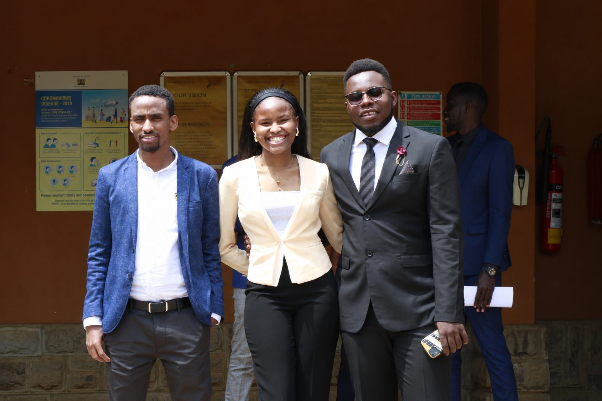
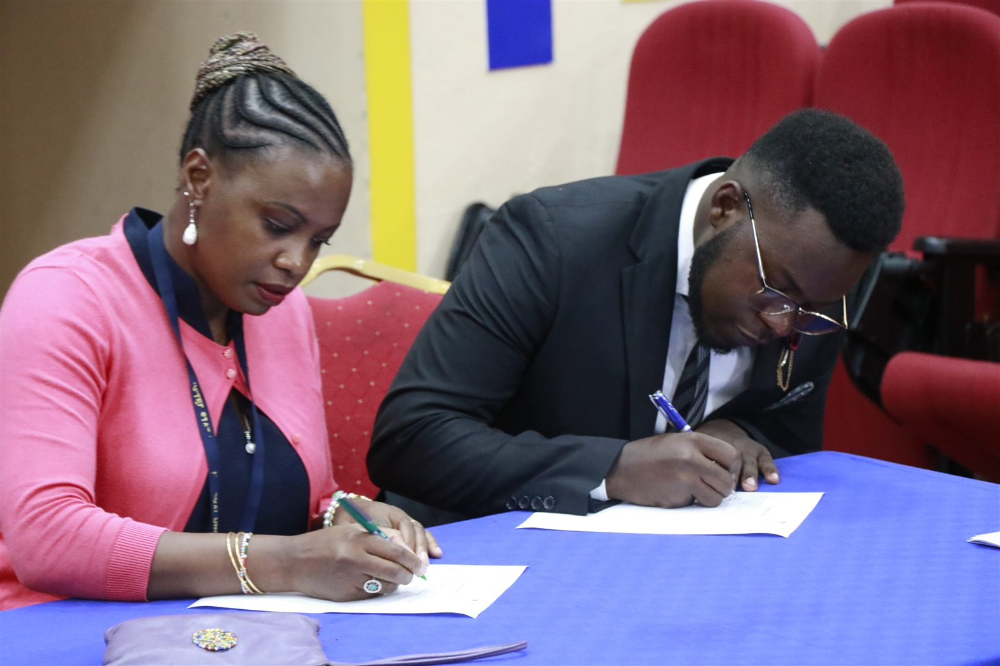
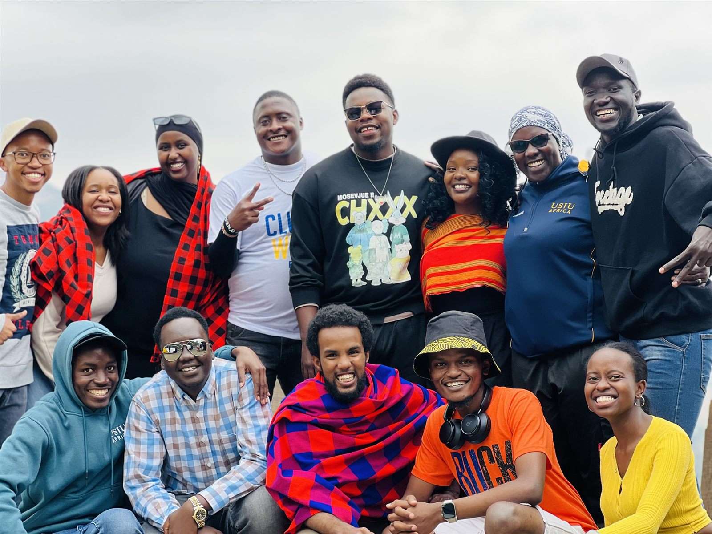
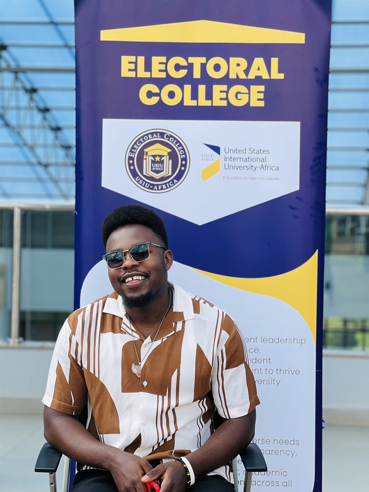
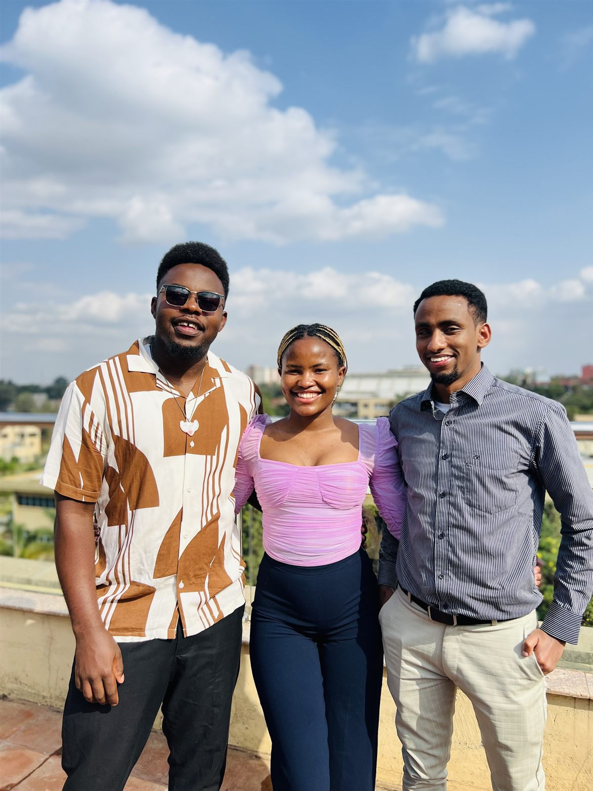
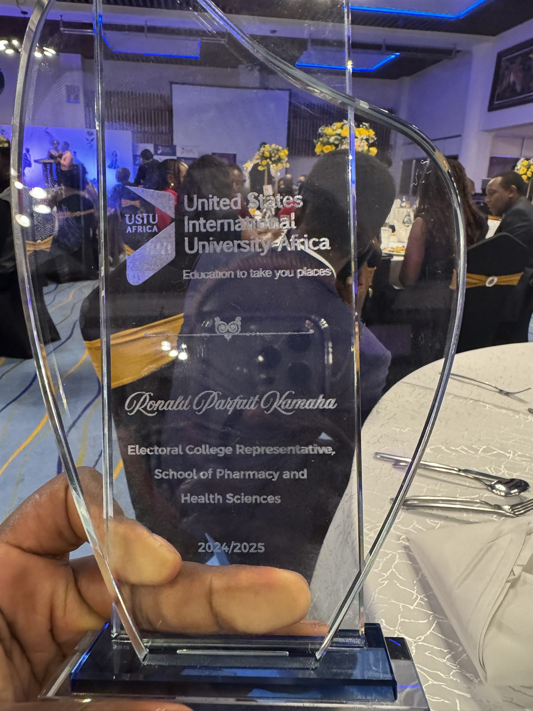

[← Leadership](../leadership.qmd){.back-link}

::: {.project-meta}
::: {}
[Role]{.k}
[Electoral College Representative]{.v}
:::
::: {}
[School]{.k}
[Pharmacy & Health Sciences]{.v}
:::
::: {}
[Team]{.k}
[Three representatives]{.v}
:::
::: {}
[Term]{.k}
[2024–2025]{.v}
:::
:::

::: {.stats}
::: {.stat}
[84]{.num}
[students vaccinated against Hepatitis B]{.label}
:::
::: {.stat}
[200+]{.num}
[pints of blood collected for children with sickle cell disease]{.label}
:::
::: {.stat}
[3]{.num}
[representatives, one team]{.label}
:::
:::

## Sworn in as a team

::: {layout="[58,42]" layout-valign="center"}
::: {}
Three of us were elected to represent students of the **School of Pharmacy & Health Sciences** on the USIU-Africa Electoral College.

We saw the role as more than passing student complaints up to the administration. Our aim was to leave behind **policies and structures** that would outlast our year in office.
:::

{.photo fig-alt="Three student representatives in formal suits stand smiling together outside a university building on swearing-in day."}
:::

{.photo .photo-mid fig-alt="Ronald, in a dark suit, signs the oath of office at a blue-covered table beside a university official in a pink cardigan."}

## Student health and safety

**Hepatitis B vaccination.** Health sciences students were entering anatomy labs and clinical rounds without standard immunisations, a clear occupational hazard. We drafted and pushed through a **mandatory Hepatitis B vaccination policy**, then ran a multi-dose vaccination drive that immunised an initial group of **84 high-risk students**.

**Blood donation.** To help address national blood shortages, we organised a **four-day blood drive** with the **Children Sickle Cell Foundation** and the **Red Cross Club**, collecting **more than 200 pints** of blood for children with sickle cell disease.

## Research and data for students

**A shared data repository.** Epidemiology students had few real datasets to work with. We opened discussions with the university's institutional research officers about building an ethically managed **central academic data repository**, and submitted a detailed proposal to create it from existing pharmaceutical innovation data.

**A path to publication.** Through the **EpiBio Research Committee**, we set up training to guide students through drafting review papers, so they could move from coursework to published work.

## Fairness and student welfare

**Fee interest waivers.** Miscommunication about internal fee structures left whole student cohorts with unfair charges and accrued interest. We reviewed the discrepancies and took the issue directly to the university's finance leadership, securing **interest waivers** for the affected students.

**"No Sex for Marks."** We ran integrity and awareness campaigns, including the **"No Sex for Marks"** campaign, to promote academic fairness, psychological safety and professional respect across the faculty.

## Looking back and handing over

Before leaving office, we held a **retreat** to review the year honestly: what worked, what didn't, and what we would recommend to the next team. A year after being sworn in, we handed over to the **2025–2026** representatives.

{.photo fig-alt="A large, smiling group of student leaders and staff, some wrapped in red Maasai shukas, pose together outdoors under an overcast sky."}

::: {.gallery layout-ncol=3}
{.photo fig-alt="Ronald, smiling in sunglasses and a brown-and-white patterned shirt, sits in front of a USIU-Africa Electoral College banner."}

{.photo fig-alt="The three representatives stand together on a sunny rooftop with the Nairobi skyline behind them."}

{.photo fig-alt="A glass award engraved with the USIU-Africa logo, Ronald Parfait Kamaha, Electoral College Representative, School of Pharmacy and Health Sciences, 2024/2025, held up at a dinner event."}
:::

::: {.next-project}
Back to: [Leadership →](../leadership.qmd)
:::
