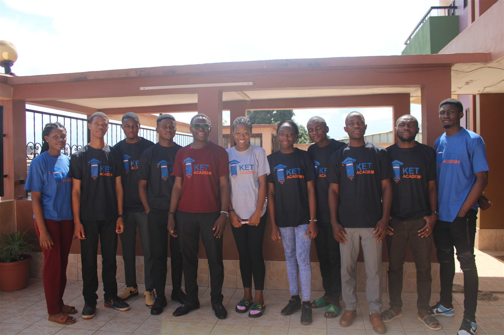
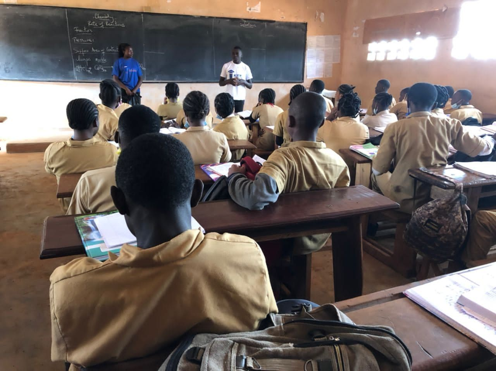
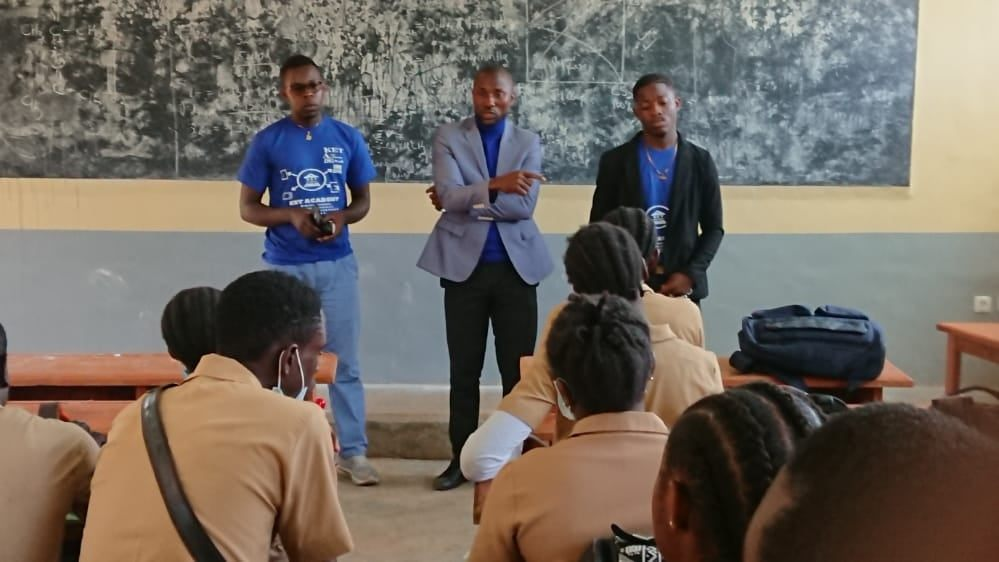
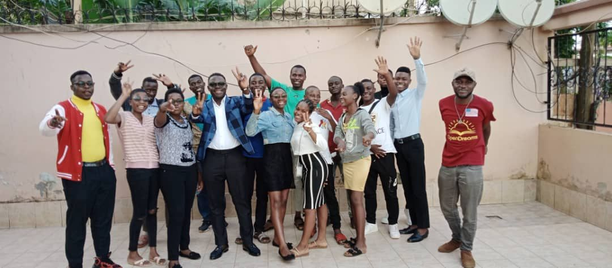

[← Leadership](../leadership.qmd){.back-link}

::: {.project-meta}
::: {}
[Role]{.k}
[Chief Operating Officer]{.v}
:::
::: {}
[Programmes]{.k}
[KET Academy · CEL · ExperienceUni]{.v}
:::
::: {}
[Setting]{.k}
[Cameroon (remote)]{.v}
:::
::: {}
[Period]{.k}
[Joined Sep 2021 · COO since Sep 2023]{.v}
:::
:::

::: {.stats}
::: {.stat}
[5,000+]{.num}
[high-school students reached]{.label}
:::
::: {.stat}
[100+]{.num}
[academic resources (PDFs)]{.label}
:::
::: {.stat}
[90+]{.num}
[instructional videos]{.label}
:::
:::

## Why KET exists

KET started as a **rapid-response education effort** during the **Anglophone crisis** in Cameroon, when conflict disrupted schooling for many students. I joined KET in September 2021 and have served as Chief Operating Officer since September 2023, working with our core team to grow it from a grassroots initiative into a **national digital education platform**. It now runs three programmes: **KET Academy**, **CEL** and **ExperienceUni**.

{.photo fig-alt="Eleven members of the KET Academy team in KET Academy t-shirts stand in a row on a sunny terrace."}

## Three programmes

::: {.card-grid .three}
::: {.pcard .linked}
[Learning platform]{.tag}

### KET Academy

Our digital platform for high-school students, with GCE exam preparation, AI-assisted learning (K-AI) and digital libraries.

[GCE prep · K-AI · Libraries]{.methods} [Read more →](https://ket.academy/){.read-more .stretched-link}
:::

::: {.pcard .linked}
[Charitable branch]{.tag}

### CELs: Community, Entrepreneurship & Leadership

Keeping children in school, with a caring adult mentor beside every student.

- **Scholarships:** sponsorships that fully cover school fees, textbooks, school bags and GCE exam registration through the end of high school.
- **Mentorship:** with **Providence Action**, every sponsored student is paired with a vetted mentor.
- **Alumni network:** graduates come back as mentors, sponsors and leaders for the next generation.

[Scholarships · Mentorship · Alumni]{.methods} [Read more →](https://ket.academy/cels){.read-more .stretched-link}
:::

::: {.pcard .linked}
[University branch · in development]{.tag}

### ExperienceUni

Guiding students into, through and beyond university: applications, essential skills and career readiness. It is being built with partners who already help Cameroonian students reach and succeed at university, including **Open Dreams** and **Impact Axis**.

[Applications · Skills · Careers]{.methods} [Read more →](https://ket.academy/experience-uni){.read-more .stretched-link}
:::
:::

## From WhatsApp groups to ket.academy

Students first found us through informal WhatsApp groups and online communities. We consolidated that content, distributing **100+ academic PDFs** and building a **YouTube library of 90+ instructional videos**. We then moved everything onto our own web platform, **[ket.academy](https://ket.academy/)**, which brings together **GCE exam preparation**, **AI-assisted learning (K-AI)** and digital libraries in one place.

## Running the organisation

To keep up with growth, we built shared workflows across departments using **Notion, Coda.io and Google Workspace**, set **departmental KPIs** and standardised our documentation. This moved the team from reacting to tasks to planning ahead using data. We are now moving to **Microsoft Teams** to make cross-team management easier as we grow.

## Reaching students on the ground

Reaching students across Cameroon means working within real constraints: limited funding and insecurity, especially in the **Northwest, Southwest and Northern** regions. Rather than spreading thin, we focused our **ambassador network** on the **Centre, Littoral and West** regions, where ambassadors visit schools and sign students up.

Volunteer networks naturally lose people every year, so we run an **annual recruitment cycle** to keep regional teams staffed.

::: {.gallery .wide layout-ncol=2}
{.photo fig-alt="Two KET ambassadors speak at the front of a classroom of uniformed high-school students, seen from behind, with chemistry notes on the blackboard."}

{.photo fig-alt="Three KET team members in blue KET Academy shirts address uniformed students in a classroom."}
:::

{.photo fig-alt="A large, cheerful group of young KET ambassadors and team members pose with raised hands and peace signs on a tiled terrace."}

## What's next

We are now planning a move to a **hybrid model**, starting with our **first physical learning centre**, to reach students who still can't get online.

::: {.project-links}
[<i class="bi bi-globe"></i> Visit ket.academy](https://ket.academy/){.btn .btn-primary}
[<i class="bi bi-heart"></i> CELs](https://ket.academy/cels){.btn .btn-outline-primary}
[<i class="bi bi-mortarboard"></i> ExperienceUni](https://ket.academy/experience-uni){.btn .btn-outline-primary}
:::

::: {.next-project}
Back to: [Leadership →](../leadership.qmd)
:::
