[← Leadership](../leadership.qmd){.back-link}

::: {.project-meta}
::: {}
[Role]{.k}
[Project Lead]{.v}
:::
::: {}
[Partner]{.k}
[Angaza Foundation]{.v}
:::
::: {}
[Setting]{.k}
[Kibera, Nairobi]{.v}
:::
::: {}
[Period]{.k}
[Apr 2023 – Jan 2024]{.v}
:::
:::

::: {.stats}
::: {.stat}
[28]{.num}
[young mothers trained and equipped]{.label}
:::
::: {.stat}
[$350]{.num}
[seed funding]{.label}
:::
::: {.stat}
[$500]{.num}
[compounding profit within three months]{.label}
:::
::: {.stat}
[1st]{.num}
[place in the Kibera league for the youth football team]{.label}
:::
:::

## The problem

Public health crises in informal settlements are rarely solved by awareness campaigns alone. Kibera saw a **surge in teenage pregnancies in 2022–2023**, and extreme economic vulnerability was pushing many young women into **transactional relationships** to meet basic survival needs.

Local NGOs were already providing psychosocial counselling. What was missing was an **economic alternative**: a way to earn that could replace the income those relationships provided.

## Funding and partnership

I was appointed project lead after the **Mastercard Foundation Transformative Leadership** programme. I pitched a localised intervention model to the **VS Management and Consulting** team and secured seed funding.

Rather than delivering top-down aid, we partnered with the **Angaza Foundation** and built the programme into their existing community work. This gave us immediate trust in the community and made the project workable from the start.

## Women's micro-business incubator

We worked with **28 at-risk young mothers**. We assessed what each of them needed, bought materials as cheaply as possible, and ran a skills programme that combined **bookkeeping training** with **mobile hair-braiding instruction** from experienced braiders. The goal was to move the women from economic dependency to earning their own income.

::: {.gallery layout-ncol=2}
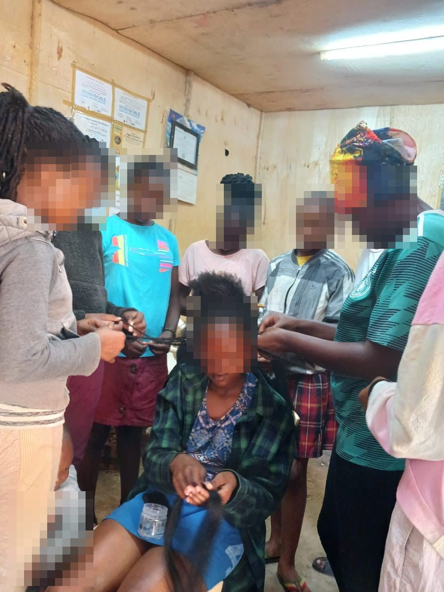{.photo fig-alt="A group of young women gathered around a seated woman, practising braiding techniques together inside a plywood-walled community room. Faces are pixelated."}

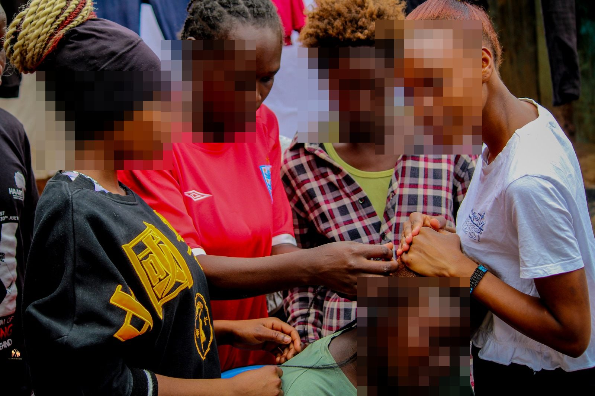{.photo fig-alt="Four young women lean in to work on a seated woman's hair outdoors. Faces are pixelated."}
:::

::: {.gallery .wide layout-ncol=2}
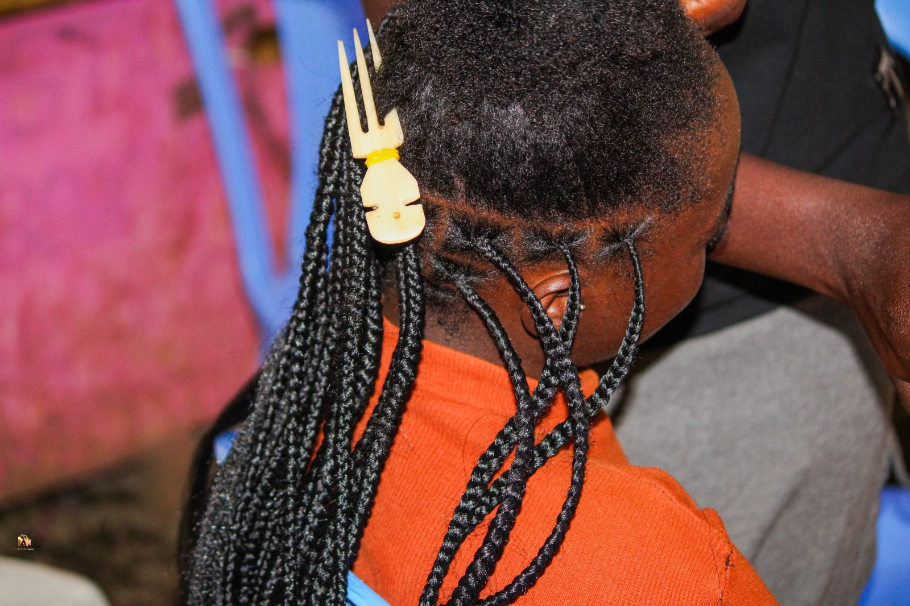{.photo fig-alt="Close-up of neat box braids with a carved bone hair pick, worn by a woman in an orange top."}

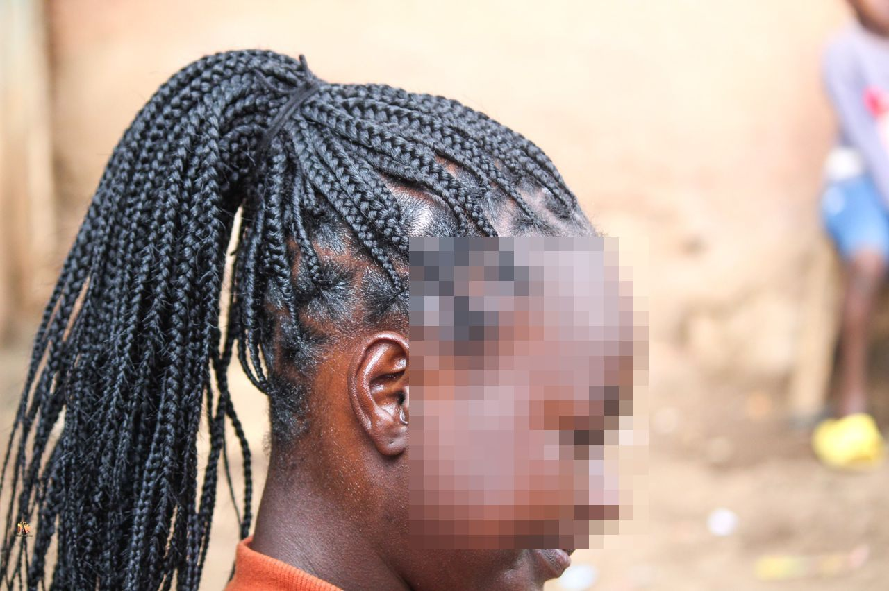{.photo fig-alt="Side profile of a woman with long box braids pulled into a high ponytail. Her face is pixelated."}
:::

## Youth football programme

At the same time, we addressed community safety. We used part of the funding to fully kit out a **community football team run by Angaza**, giving young men a positive alternative to the local cycle of crime.

Before buying anything, we watched the team's training sessions to understand what they actually needed. We then bought full kits and followed the team through the Kibera league. **Three months after the intervention, the team won the Kibera tournament.**

::: {.gallery .wide layout-ncol=3}
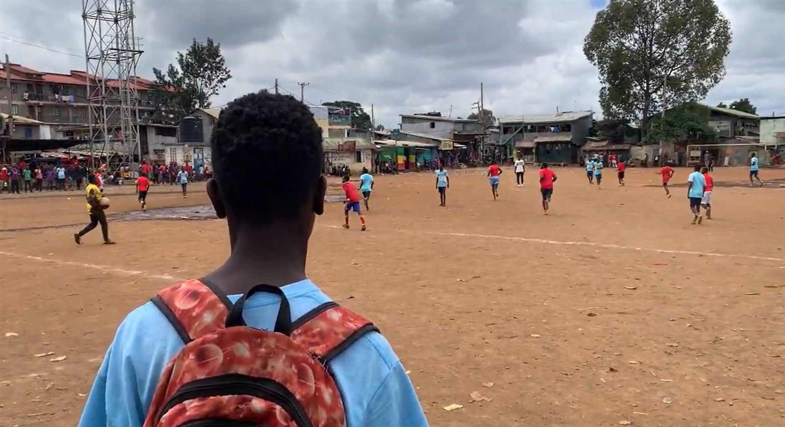{.photo fig-alt="Seen from behind, a young man watches a football training session on a dusty pitch surrounded by Kibera buildings."}

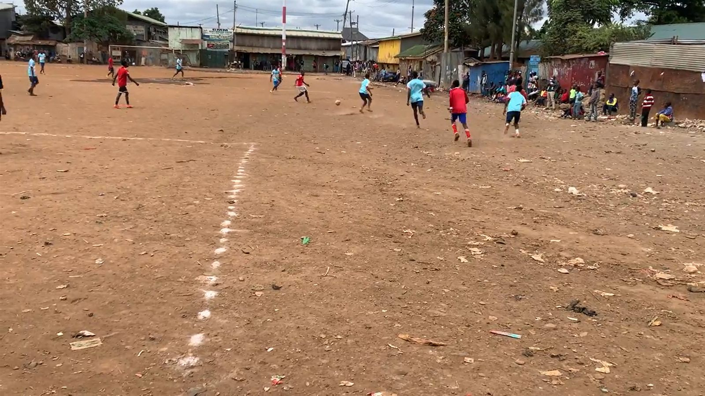{.photo fig-alt="Players in red and light-blue shirts train on a wide dirt pitch with spectators along the edge."}

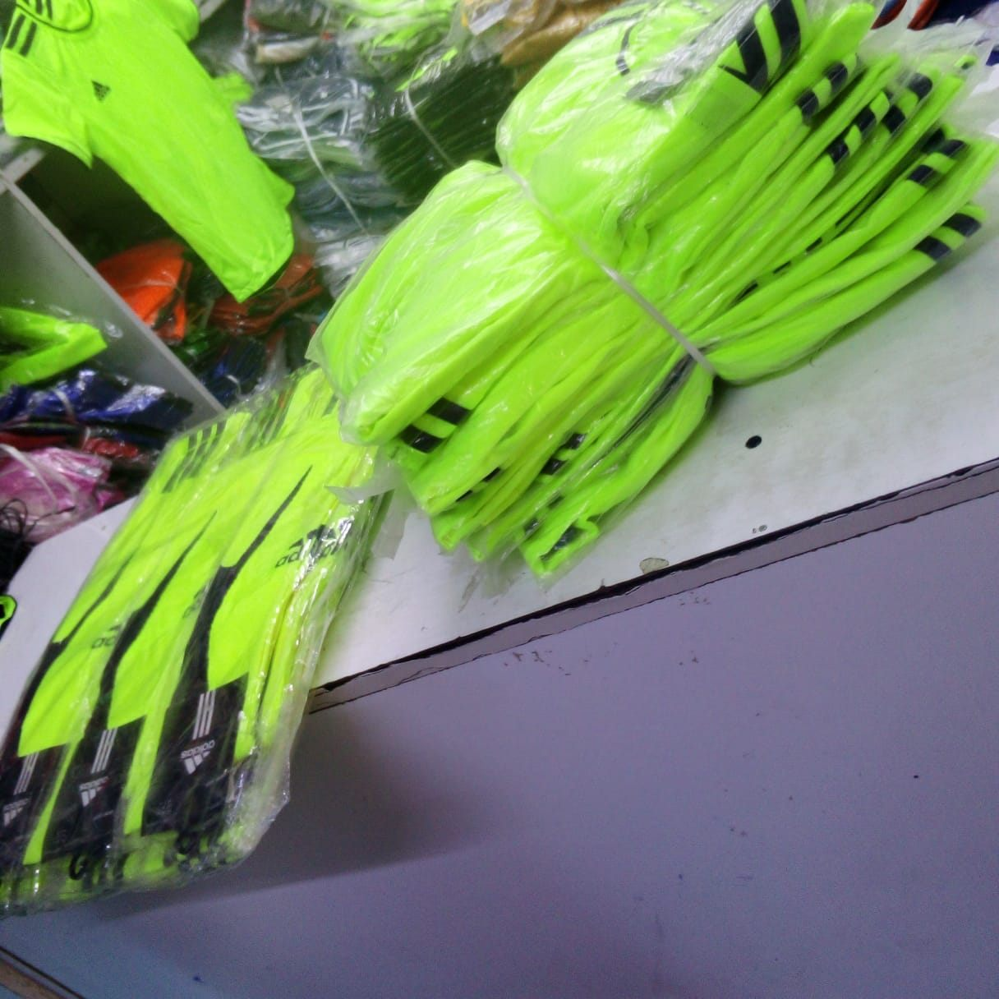{.photo fig-alt="Stacks of new neon-green football kits wrapped in plastic on a shop counter."}
:::

::: {.gallery .wide layout-ncol=3}
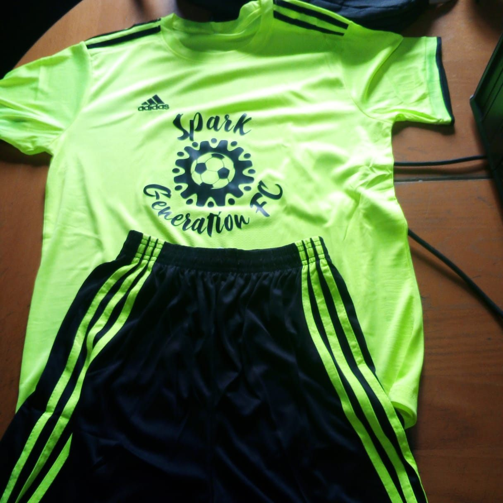{.photo fig-alt="A neon-green football shirt printed with the Spark Generation FC logo, laid out with black shorts with green stripes."}

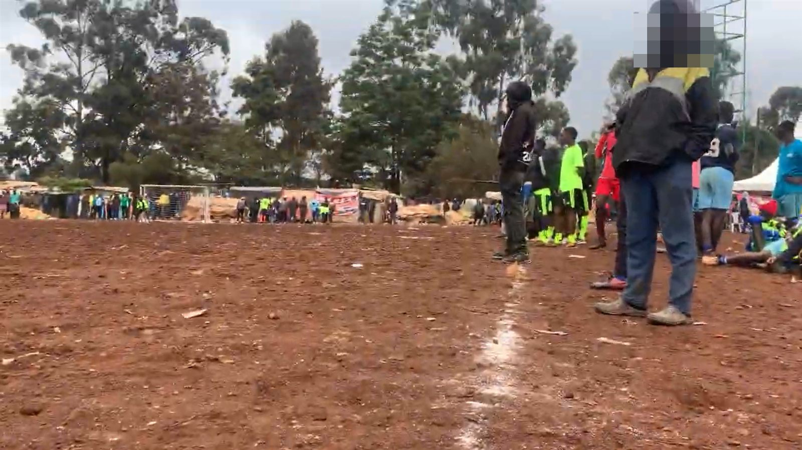{.photo fig-alt="A red-dirt pitch with spectators and players in neon-green kits gathered along the touchline. The nearest spectator's face is pixelated."}

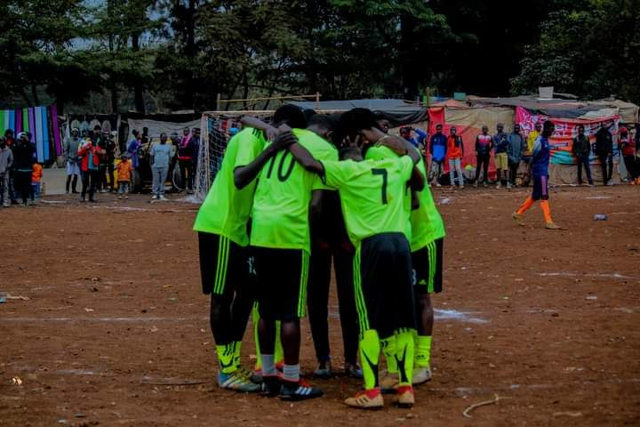{.photo fig-alt="Players in neon-green kits huddle together on the pitch before the final, with a crowd watching behind them."}
:::

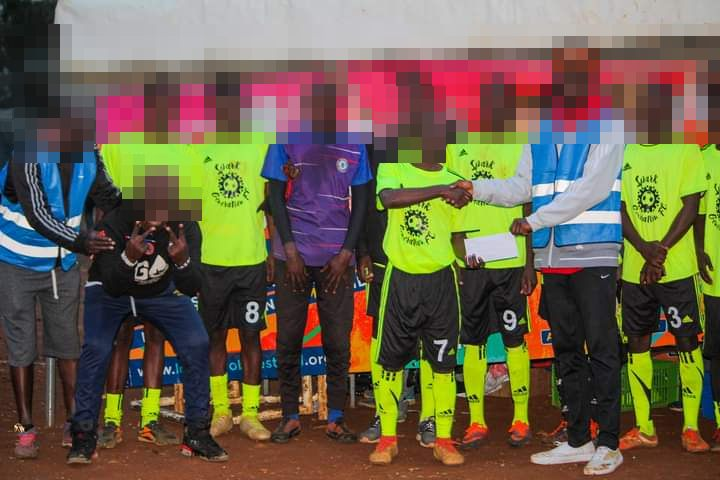{.photo .photo-mid fig-alt="The team in neon-green kits lines up as a player shakes hands with an official presenting an envelope. Faces are pixelated."}

## Funding shortfall and handover

The biggest obstacle was money: community demand far exceeded our **$350 in seed funding**, so the project depended on becoming profitable quickly.

Within three months, the women's mobile braiding group generated a **compounding profit of $500**. Part of it was reinvested to grow the businesses and ease the funding shortfall. The rest covered daily needs and childcare. The new income replaced what had previously come from transactional relationships, tackling the community's main public health risk at its root.

After **three months of oversight and financial auditing**, we published an impact report and handed full operational and financial control to the women.

::: {.gallery .wide layout-ncol=2}
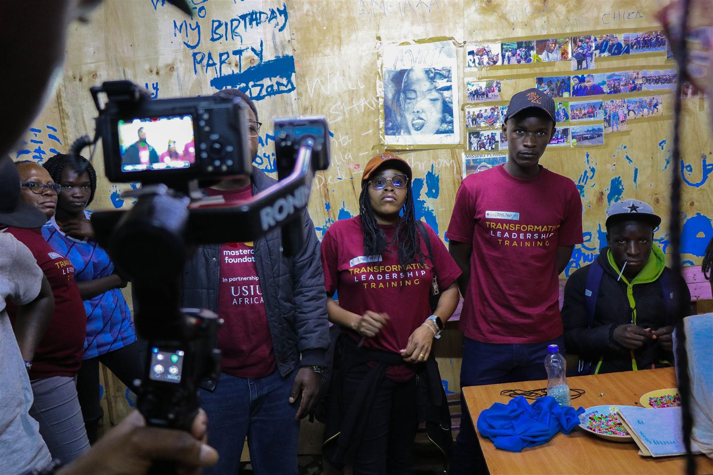{.photo fig-alt="Ronald and other Transformative Leadership Training participants in maroon t-shirts stand in a community room while a camera on a gimbal records the report."}

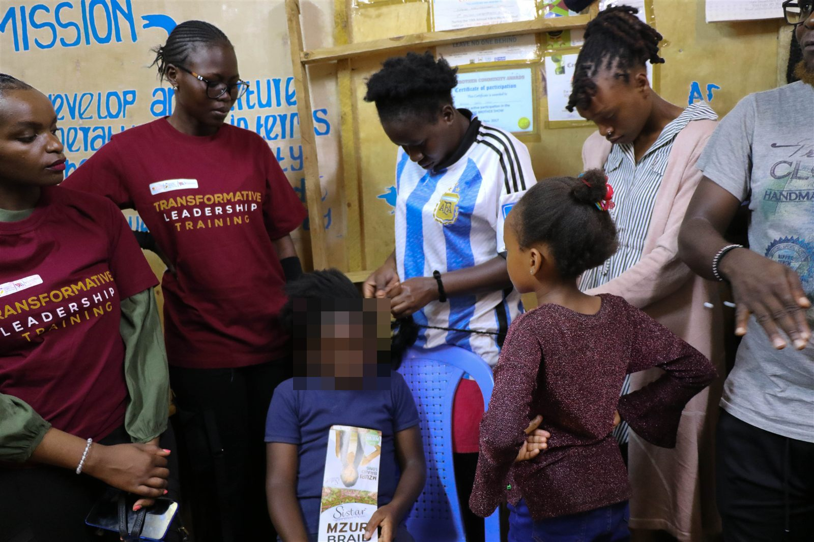{.photo fig-alt="A young woman braids a girl's hair while Transformative Leadership Training participants and community members watch."}
:::

::: {.privacy-note}
<i class="bi bi-shield-lock"></i> This project worked with vulnerable people, so participants' faces are pixelated, and children's faces are always hidden.
:::

::: {.next-project}
Back to: [Leadership →](../leadership.qmd)
:::
