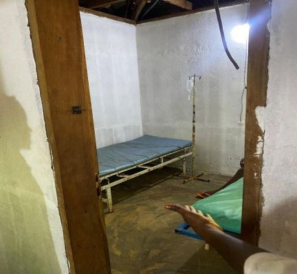
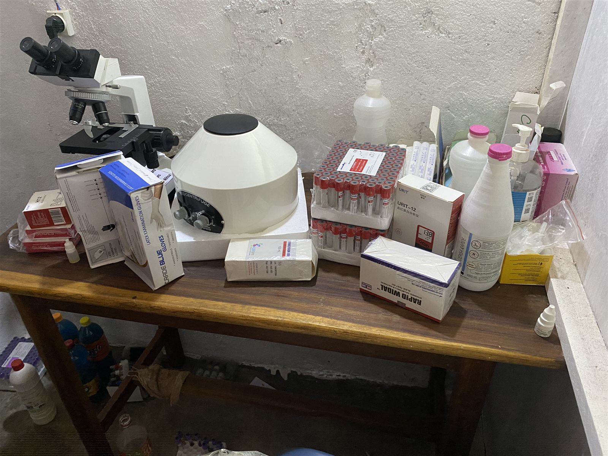
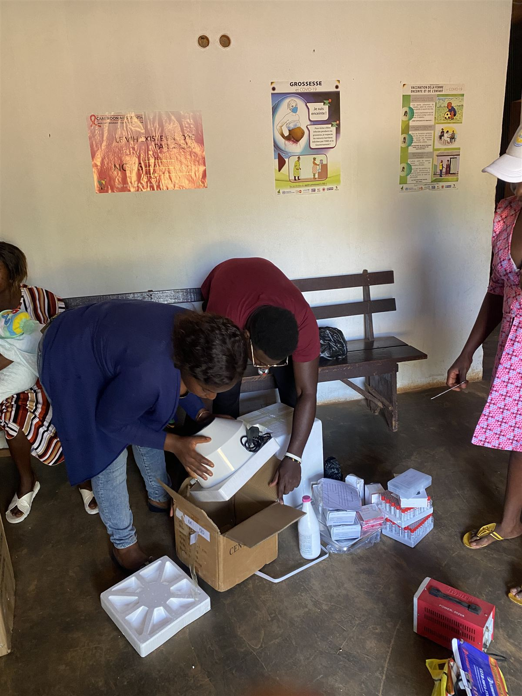
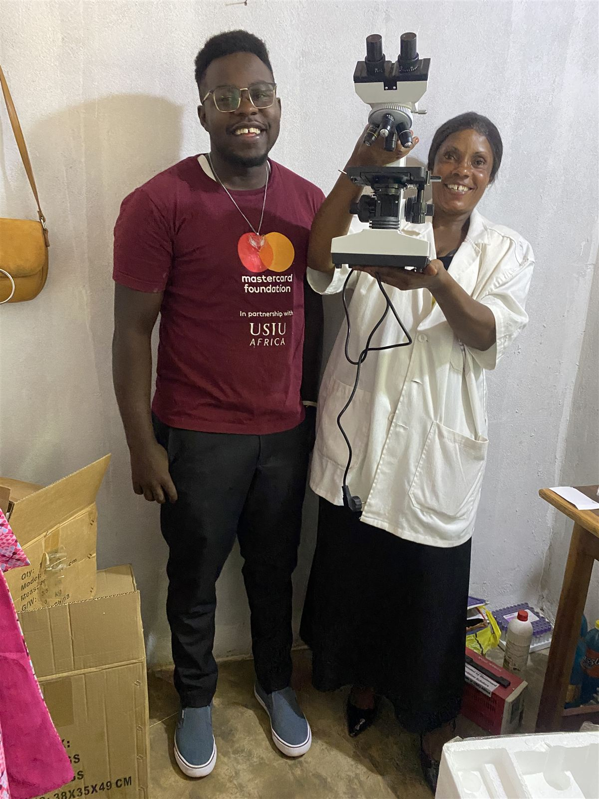
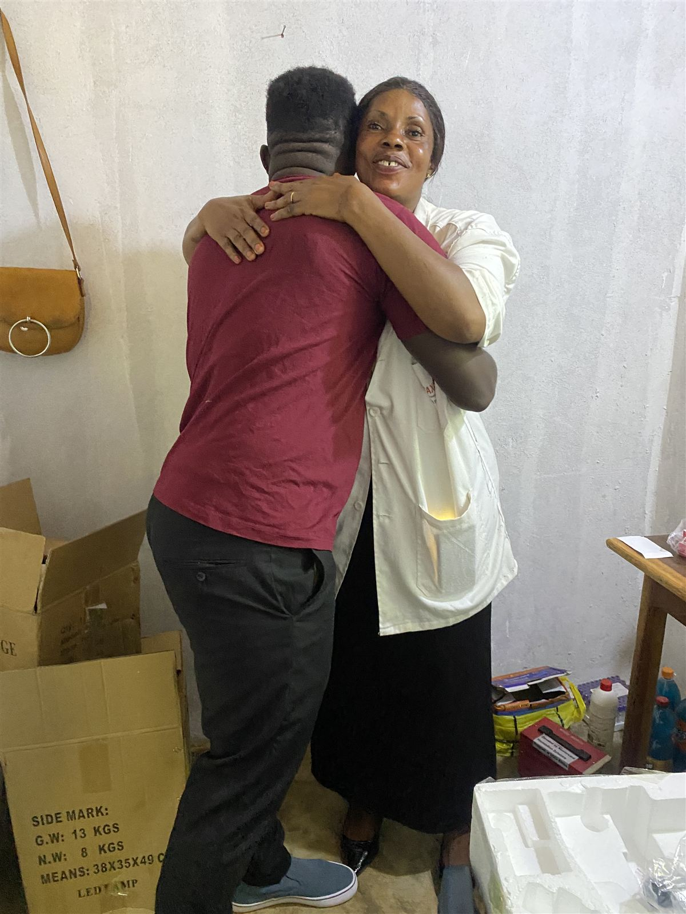
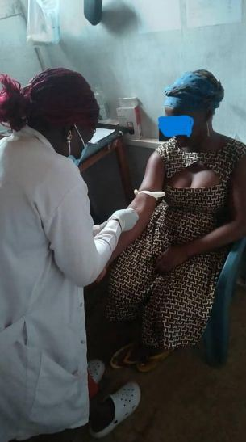

[← All research](../research.qmd){.back-link}

::: {.project-meta}
::: {}
[Role]{.k}
[Founder & Lead]{.v}
:::
::: {}
[Setting]{.k}
[Batoukop, West Cameroon]{.v}
:::
::: {}
[Period]{.k}
[Dec 2024 – Dec 2025]{.v}
:::
::: {}
[Funding]{.k}
[≈ $1,000 secured]{.v}
:::
:::

## The problem

::: {layout="[58,42]" layout-valign="center"}
::: {}
Batoukop's health centre had beds but almost nothing else. Consultation and delivery rooms were **empty, scantily furnished and under-resourced**. Residents had to travel to get even basic diagnostic tests.

As a result, the community had **no systematic data on its own disease burden**.
:::

{.photo fig-alt="A small bare room with concrete walls, a single metal bed with a blue mattress and an IV drip stand, lit by one bulb."}
:::

## Equipping the clinic

I secured about **$1,000** and spent it on the essentials for a working diagnostic bench: a binocular **microscope**, a **centrifuge**, a **haemoglobin analyser**, **Widal slide test kits**, blood collection tubes, slides, immersion oil, reagents and gloves.

{.photo fig-alt="A wooden table holding a microscope, a centrifuge, racks of blood collection tubes, a URIT-12 haemoglobin analyser, a Rapid Widal test kit, boxes of gloves and bottles of reagents."}

::: {.gallery layout-ncol=3}
{.photo fig-alt="Two people unpack a centrifuge from a cardboard box on the floor of a clinic waiting room, beside boxes of supplies and racks of tubes."}

{.photo fig-alt="Ronald, in a Mastercard Foundation and USIU-Africa t-shirt, stands beside the clinic director in a white coat, who holds up the new microscope."}

{.photo fig-alt="The clinic director, smiling, hugs Ronald after receiving the equipment."}
:::

## The open clinic

::: {layout="[58,42]" layout-valign="center"}
::: {}
With the equipment in place, I designed and ran a **one-month free testing clinic**. Community members came in for blood sampling and on-site testing for **malaria**, **typhoid (Widal)** and **anemia**.

I then analysed the results to produce the community's first baseline prevalence figures and recommended **clinical follow-up and referral pathways** for people who needed further care.
:::

{.photo fig-alt="A health worker in a white coat and gloves draws blood from the arm of a seated woman whose face is blurred."}
:::

## Findings

::: {.stats}
::: {.stat}
[58%]{.num}
[malaria positivity]{.label}
:::
::: {.stat}
[71%]{.num}
[Widal test positivity]{.label}
:::
::: {.stat}
[28%]{.num}
[mild anemia]{.label}
:::
::: {.stat}
[5%]{.num}
[severe anemia]{.label}
:::
:::

These are the community's **first systematic baseline prevalence figures**. The anemia burden in particular led to recommendations for clinical follow-up and referral.

<!-- TODO: add number tested and age/sex breakdown. -->

::: {.project-links}
[<i class="bi bi-linkedin"></i> Read the LinkedIn post](https://lnkd.in/p/d9b9Z6sk){.btn .btn-outline-primary}
[<i class="bi bi-envelope"></i> Want to have access to the data?](mailto:ronaldkamaha2@gmail.com?subject=Data%20request%3A%20Batoukop%20diagnostic%20baseline){.btn .btn-primary}
:::

::: {.next-project}
Back to: [Maternal mortality in Kenya →](maternal-mortality-kenya.qmd)
:::
