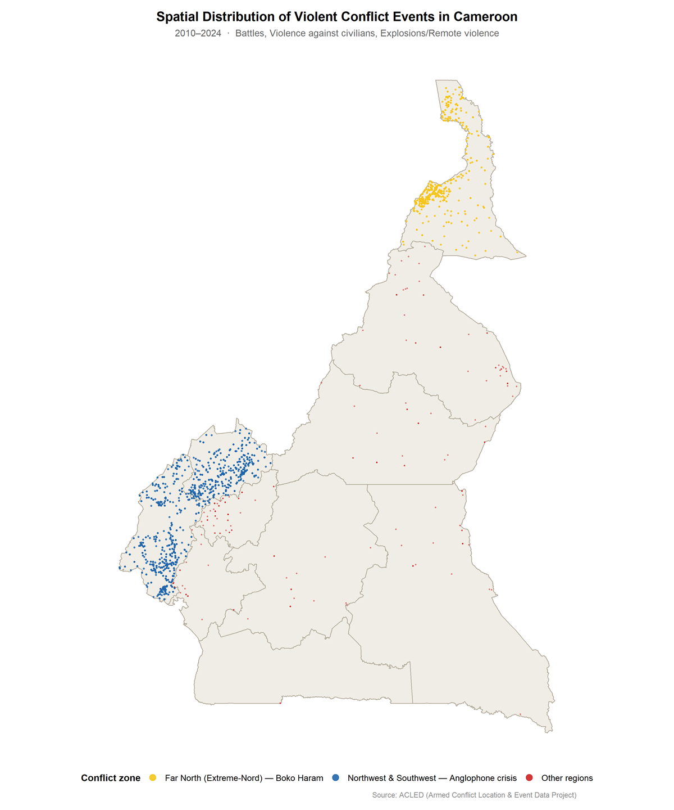

[← All research](../research.qmd){.back-link}

::: {.project-meta}
::: {}
[Type]{.k}
[Research in progress]{.v}
:::
::: {}
[Setting]{.k}
[Cameroon, 1 km grid (21,886 cells)]{.v}
:::
::: {}
[Period]{.k}
[2010–2024]{.v}
:::
::: {}
[Methods]{.k}
[Conflict Exposure Index, panel DiD-ITS, R]{.v}
:::
:::

::: {.callout-note appearance="simple"}
## Work in progress
This page presents the **question, data and modelling framework**. Effect estimates are still being refined and validated, and will be added once the work has been peer-reviewed. The conflict map below is a description of public ACLED data, not a model result.
:::

## The question

Sub-Saharan Africa carries about 95% of the world's malaria cases ([WHO, 2025](https://www.who.int/news-room/fact-sheets/detail/malaria)), and it is also the region with the most armed conflicts. Malaria risk maps are usually built from climate and environment, and they assume people live where their livelihoods are. **Conflict breaks that assumption.** It displaces people towards higher-risk areas, interrupts bed-net and spraying campaigns, and keeps health workers and patients away from clinics.

Studies agree that conflict raises malaria risk, but the size of the effect is rarely estimated. Most also treat conflict as simply present or absent, ignoring differences in intensity.

Cameroon offers an unusual natural experiment: **two separate conflicts, in different places, starting at different times.**

- **Far North:** the Boko Haram insurgency, escalating from early 2014.
- **Northwest and Southwest:** the Anglophone crisis, which began as peaceful protests in late 2016 and escalated into armed conflict.

## Where the violence happened

{.photo .photo-mid fig-alt="Map of Cameroon with dots for violent conflict events: a dense yellow cluster in the Far North, a dense blue cluster across the Northwest and Southwest regions, and scattered red dots elsewhere in the country."}

Over the study period, the Armed Conflict Location & Event Data project ([ACLED](https://acleddata.com)) recorded more than 22,000 violent events in Cameroon. Annual events stayed low until 2013, rose after Boko Haram became active in 2014, and climbed steeply from 2016 onwards as the Anglophone crisis escalated. Almost all events fall in the two conflict zones. The Northwest, Far North and Southwest together account for the vast majority of events and fatalities.

## A new measure: the Conflict Exposure Index

Instead of labelling places as simply "in conflict" or "not in conflict", I built a **continuous Conflict Exposure Index (CEI)** for every 1 km cell and every month. The idea is that each violent event affects nearby people most, and fades with distance and time:

$$
\text{CEI}(s,t) = \sum_{e} \; w_{\text{severity}}(e) \times w_{\text{spatial}}(e,s) \times w_{\text{temporal}}(e,t)
$$

::: {.card-grid .three}
::: {.pcard}
[Severity]{.tag}

#### How violent was it?

Event type is weighted (battles 1.0, violence against civilians 1.5, explosions 2.0) and multiplied by a log-scaled fatality count, so that intensity counts but extreme events don't dominate.
:::

::: {.pcard}
[Distance]{.tag}

#### How close was it?

Influence decays exponentially with distance from the event, calibrated at about 25 km from the literature.
:::

::: {.pcard}
[Time]{.tag}

#### How recent was it?

Influence decays exponentially over time, calibrated at about 30 days, so recent events weigh more than old ones.
:::
:::

## Data

| Source | What it provides | Resolution |
|---|---|---|
| [ACLED](https://acleddata.com) | Geocoded violent conflict events and fatalities | Event-level |
| [Malaria Atlas Project](https://malariaatlas.org) | Annual *P. falciparum* parasite rate (transmission suitability) | 5 km, resampled to 1 km |
| [WorldPop](https://www.worldpop.org) | Annual population counts | 100 m, aggregated to 1 km |

All three are openly available. Analyses are run in **R** (terra, tidyverse, fixest), and the analysis scripts will be shared in a public repository.

## Study design

- **Grid:** Cameroon is divided into **21,886 one-kilometre cells**, each followed monthly from 2010 to 2024.
- **Comparison groups:** cells in the Far North and in the Northwest/Southwest are compared with cells in the seven regions largely unaffected by conflict.
- **Model:** a panel **difference-in-differences interrupted time series** with cell fixed effects. Each cell is compared with its *own* pre-conflict trajectory, so geography, ecology and pre-existing health infrastructure are controlled for. The key question is: *after conflict began, did exposure grow faster in conflict areas than in peaceful ones?*
- **Robustness:** sensitivity checks on the distance and time decay parameters and on how conflict is assumed to modify exposure, with further validation in progress.

## Early direction

Preliminary analysis suggests that conflict worked through **gradual erosion rather than a sudden shock**. There was no immediate jump in exposure when conflict began, but a steadily diverging trend afterwards. The current work focuses on separating effects driven by the data, such as population displacement towards higher-suitability areas, from those that depend on modelling assumptions.

## Why it matters

Malaria programmes usually plan around climate and ecology. If conflict independently reshapes who is exposed and where, then conflict-affected regions need malaria responses designed for **disrupted health systems and displaced populations**, not only for the local transmission environment. A continuous, reusable conflict exposure measure could also be applied to other diseases and other conflict settings.

::: {.next-project}
Next project: [Field attachment: KUTRRH & KNPHI →](surveillance-kenya.qmd)
:::
