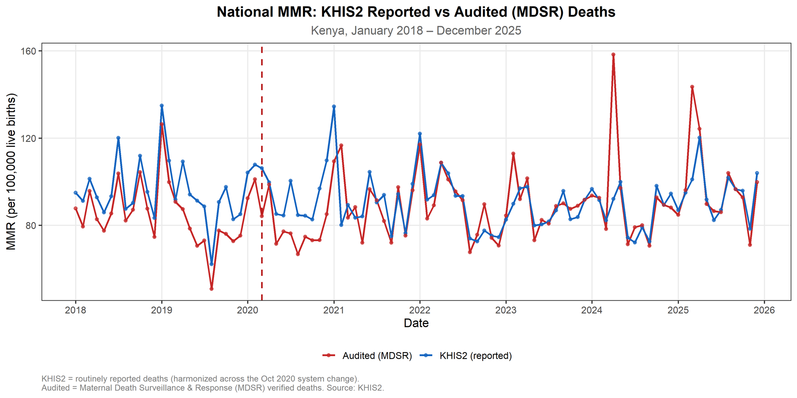

[← All research](../research.qmd){.back-link}

::: {.project-meta}
::: {}
[Type]{.k}
[BSc thesis, USIU-Africa]{.v}
:::
::: {}
[Status]{.k}
[Submitted July 2026 · not yet peer-reviewed]{.v}
:::
::: {}
[Data]{.k}
[KHIS2 and MDSR-audited deaths, 47 counties]{.v}
:::
::: {}
[Methods]{.k}
[ITS, counterfactual & ARIMA models, R]{.v}
:::
:::

::: {.callout-note appearance="simple"}
## About the results on this page
This is an undergraduate thesis that has **not yet been peer-reviewed**. To avoid putting unreviewed estimates into circulation, this page describes the questions, methods and direction of the findings, but **does not publish the numerical estimates, county rankings or 2030 projections**. These will be shared once the work has been through peer review. Researchers and policymakers can [request the full report](mailto:ronaldkamaha2@gmail.com?subject=Request%3A%20Maternal%20mortality%20in%20Kenya%20thesis).
:::

## The question

Global models predicted that COVID-19 could raise maternal mortality in low- and middle-income countries by 8–39% ([Roberton et al., 2020](https://doi.org/10.1016/S2214-109X(20)30229-1)). What actually happened in Kenya was poorly documented. The thesis asked:

1. How did Kenya's maternal mortality change before, during and after the pandemic (January 2018 – December 2025)?
2. Was there a measurable disruption when COVID-19 arrived, and how many deaths might it have caused?
3. How large are the differences between Kenya's 47 counties?
4. Where is Kenya heading relative to the **SDG 3.1 target** of fewer than 70 maternal deaths per 100,000 live births by 2030?

## Data

Monthly, aggregated, de-identified data from the **Kenya Health Information System (KHIS2)**, obtained through CEMA's public data warehouse. Partway through the analysis, a second series became available: maternal deaths reviewed through **Maternal Death Surveillance and Response (MDSR)**. I ran every analysis on **both** series in parallel.

Before analysis, I harmonised a change to the maternal death reporting categories made in October 2020, and corrected county entries that had been recorded in an outdated data field.

## Approach

- **Interrupted time series:** segmented regression with robust standard errors, testing for a change in level and trend at the onset of COVID-19 (March 2020) while controlling for the October 2020 reporting change. I checked the results with an autoregressive error model and a Poisson count model.
- **Counterfactual modelling:** linear, ARIMA and pre-pandemic-mean models estimated what maternal mortality *would have been* without the pandemic, to estimate excess deaths for March 2020 – December 2022.
- **County disparities:** descriptive comparison and mapping of all 47 counties, plus correlation with antenatal care and facility delivery coverage.
- **Projection to 2030:** linear and ARIMA projections compared with the SDG 3.1 target.

{.photo fig-alt="Line chart of monthly national maternal mortality ratio in Kenya from 2018 to 2025 for two data sources, KHIS2 reported deaths in blue and MDSR-audited deaths in red, with a dashed vertical line at March 2020."}

## What the analysis points to

- **The data source shapes the story.** The routine and audited series disagree on the level of maternal mortality, on the size of any pandemic effect, on which counties carry the highest burden, and even on whether Kenya is moving towards or away from the 2030 target.
- **No clear pandemic shock at the national level.** Neither series showed a statistically significant change at the onset of COVID-19. Estimates of excess deaths varied widely depending on the method and data source.
- **Large inequalities between counties.** Maternal mortality varied several-fold across counties. Antenatal and facility delivery coverage did not explain the differences, which points towards the quality of emergency obstetric care.

## Why it matters

If routine and audited data tell different stories, any single-source account of Kenya's maternal mortality should be treated as provisional. The thesis recommends reporting national figures as a **range triangulated across sources**, reconciling the two systems around the 2020 reporting change, and adding automated consistency checks to KHIS. If the data misrepresent the situation, resources go to the wrong places, and women in the most affected counties stay invisible to the system.

::: {.privacy-note}
<i class="bi bi-shield-check"></i> Approved by the USIU-Africa Institutional Scientific and Ethics Review Committee and licensed by NACOSTI. The study used only aggregated, de-identified secondary data. Supervised by Dr. Linet Angwa, USIU-Africa.
:::

::: {.next-project}
Next project: [Hidden maternal deaths in Nairobi →](nairobi-maternal-mortality.qmd)
:::
