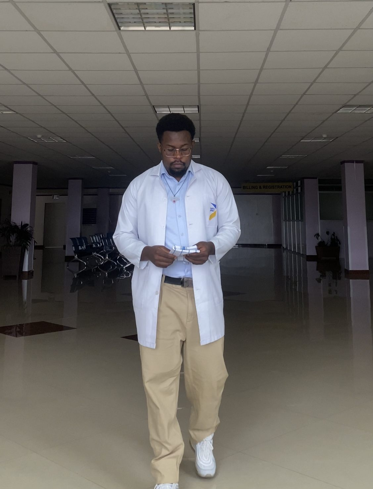
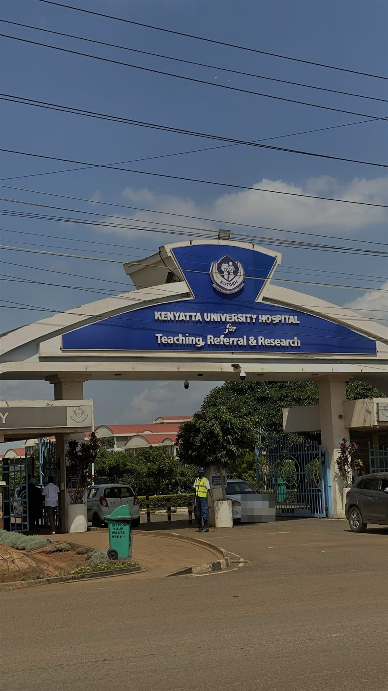
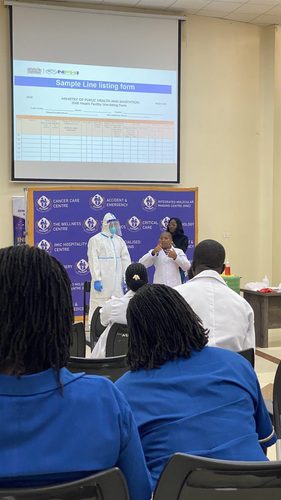
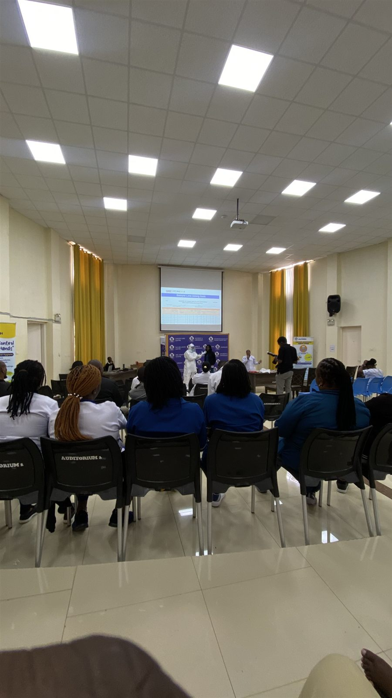
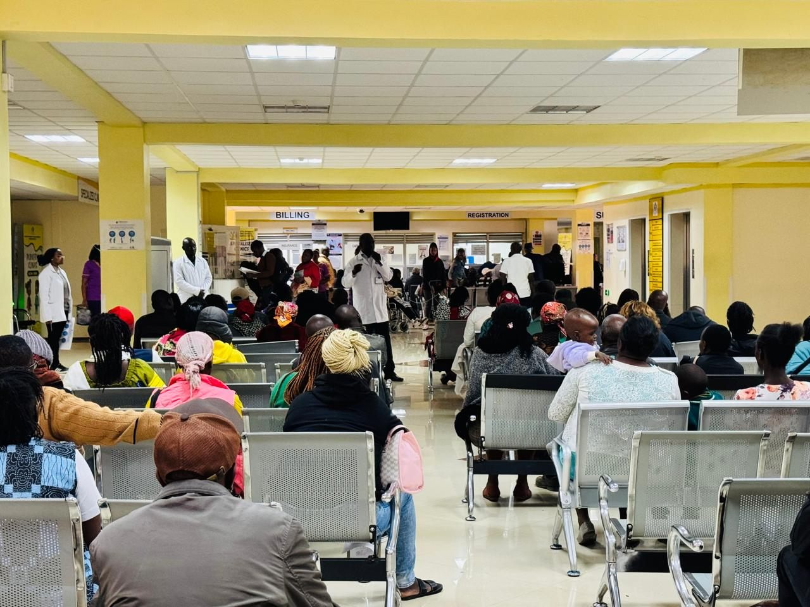
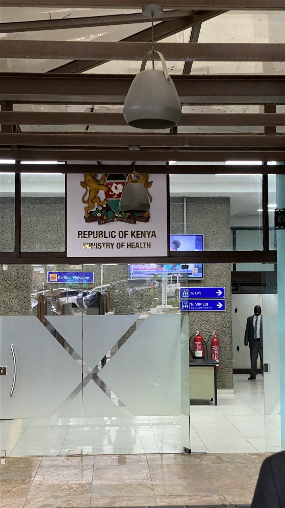
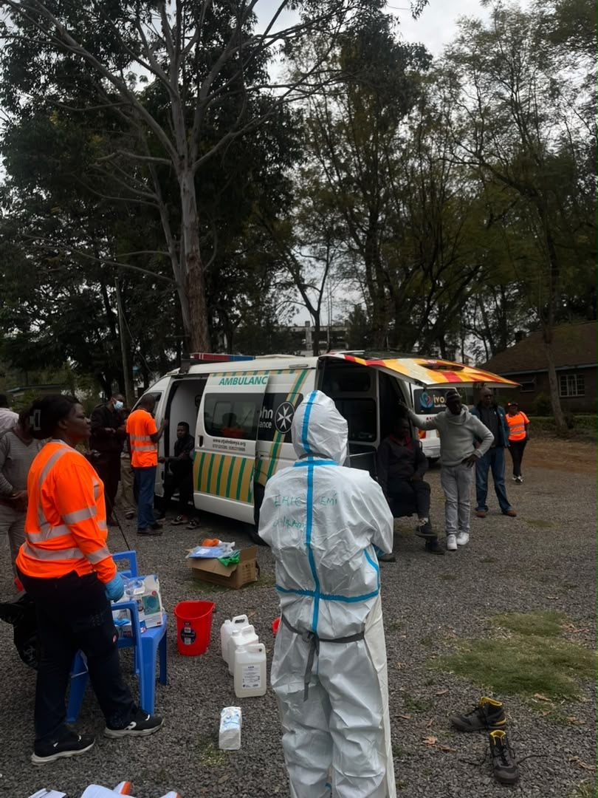
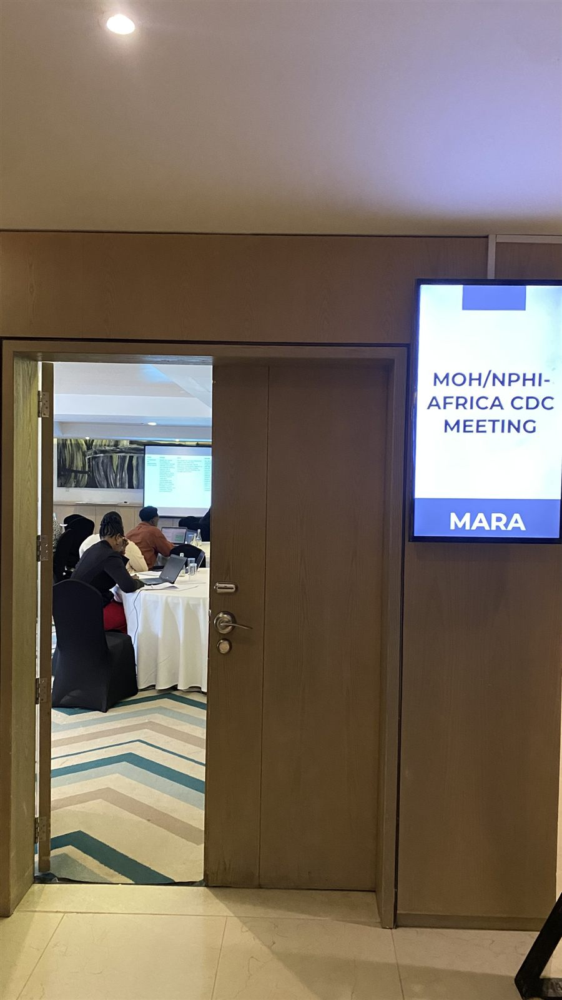
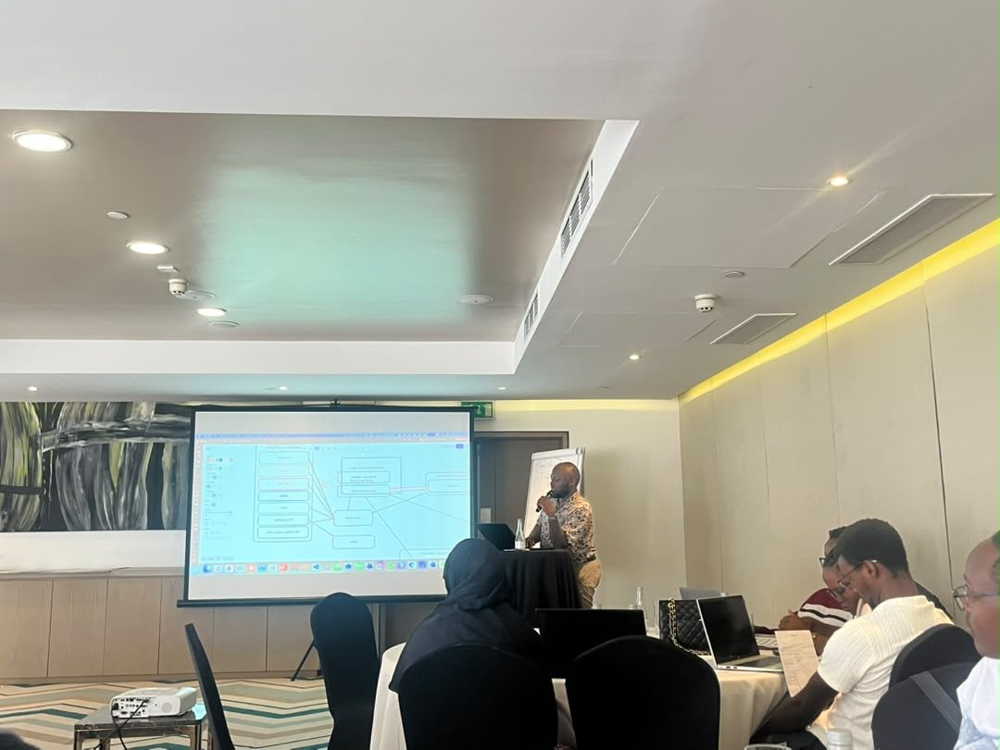

[← All research](../research.qmd){.back-link}

::: {.project-meta}
::: {}
[Programme]{.k}
[BSc Epidemiology & Biostatistics attachment]{.v}
:::
::: {}
[Sites]{.k}
[KUTRRH · KNPHI (DDSR)]{.v}
:::
::: {}
[Period]{.k}
[25 May – 13 Aug 2026]{.v}
:::
::: {}
[Focus]{.k}
[Surveillance, outbreak response, IPC]{.v}
:::
:::

::: {layout="[58,42]" layout-valign="center"}
::: {}
My final-year attachment took me through two levels of Kenya's health system. At **Kenyatta University Teaching, Referral and Research Hospital (KUTRRH)**, health data is generated at the point of care. At the **Kenya National Public Health Institute (KNPHI)**, the Division of Disease Surveillance and Response (DDSR) monitors disease and coordinates outbreak response nationally.

At both levels I kept seeing the same gap: problems were found, but nothing systematically tracked whether they were fixed.
:::

{.photo fig-alt="Ronald, in a white USIU-Africa lab coat and glasses, walks through a quiet hospital hall reading a folded sheet of paper."}
:::

::: {.stats}
::: {.stat}
[20]{.num}
[hospital wards and units inspected for infection control]{.label}
:::
::: {.stat}
[1]{.num}
[full Mpox outbreak investigation, from contact tracing to analysis]{.label}
:::
::: {.stat}
[3]{.num}
[national outbreak investigation reports critically appraised]{.label}
:::
::: {.stat}
[IDSR]{.num}
[certified (WHO Health Security Learning Platform)]{.label}
:::
:::

## KUTRRH: public health in a referral hospital {#kutrrh}

[25 May – 19 June 2026 · Public Health Department]{.activity-when}

::: {layout="[42,58]" layout-valign="center"}
{.photo fig-alt="The blue arched entrance sign of Kenyatta University Hospital for Teaching, Referral and Research, with the hospital buildings behind it."}

::: {}
KUTRRH is a Level 6 hospital, and its Public Health Department covers environmental health, infection prevention and control (IPC), active surveillance and outbreak response.

**Ward inspections.** Each morning we inspected wards for waste segregation, hygiene, supplies and infrastructure. Across **20 wards and units**, the same problems came up again and again: infectious waste in general bins, missing mosquito nets, and broken sinks and leaking roofs.

**Environmental health.** I collected borehole water samples for quality testing, assessed mosquito-net coverage across the hospital, and reviewed the pest-control procedures for bed bugs and mosquitoes.

**Disease surveillance.** Using the Ministry of Health's IDSR reporting tools, I helped identify and report notifiable conditions, including tuberculosis, severe acute malnutrition and a neonatal death.
:::
:::

### The Mpox investigation

When a confirmed Mpox case came through Accident & Emergency, I worked on the full investigation: **contact tracing, specimen collection, and maintaining the line list**. I then ran the **descriptive analysis**, calculating positivity and attack rates overall and by staff group, with demographic and geographic breakdowns, and **presented the findings to the hospital's Public Health Team**.

This was the most formative experience of the attachment: one outbreak, from the first contact to the final report. It also meant reassuring an anxious contact of the confirmed case while giving accurate guidance.

### Ebola preparedness and health education

With an Ebola outbreak in the region, I attended the hospital's **two-day Ebola training** for clinical staff, which covered preparedness, response protocols and IPC. I also supported **sensitisation campaigns** and gave health education at the Maternal Wing help desk.

::: {.gallery layout-ncol=3}
{.photo fig-alt="A trainer in full white PPE with a face shield stands beside a speaker in a white coat, under a projected slide titled Sample Line listing form."}

{.photo fig-alt="A hospital auditorium with rows of staff in blue and white uniforms facing a stage where a PPE demonstration is under way."}

{.photo fig-alt="A health worker in a white coat speaks to patients seated in rows in a bright hospital waiting hall near the billing and registration desks."}
:::

### A proposed monitoring and evaluation tool

Because the same inspection findings kept coming back, I began designing a **monitoring and evaluation (M&E) tool** for the Public Health Department. It would track recurring issues and the follow-up action taken on each, so problems are closed out rather than rediscovered every round. I continued developing it after leaving KUTRRH, and I plan to recommend that the department review and pilot it.

## KNPHI: national disease surveillance {#knphi}

[27 July – 13 August 2026 · Division of Disease Surveillance and Response]{.activity-when}

::: {layout="[58,42]" layout-valign="center"}
::: {}
My placement at KNPHI came through the Ministry of Health. It gave me a national view of how Kenya detects outbreaks, investigates them and prepares for the next one.

**IDSR certification.** After a briefing on the Integrated Disease Surveillance and Response framework, I completed **IDSR certification** on the WHO Health Security Learning Platform.

**Appraising outbreak investigations.** I critically appraised **three outbreak investigation reports**, judging whether the evidence supported each conclusion. They included a **129-case outbreak among about 1,800 students** at two girls' schools in Kakamega County, and a swelling-hands cluster in Marsabit.

**Visceral leishmaniasis.** I carried out a descriptive biostatistical analysis of an outbreak dataset, comparing mortality across clinical treatment regimens.
:::

{.photo fig-alt="The glass entrance of the Ministry of Health building with the Republic of Kenya coat of arms and a Ministry of Health sign above the doors."}
:::

### Ebola emergency response training

I completed a **three-day Ebola Virus Disease (EVD) emergency response training** for frontline paramedics. It covered EVD epidemiology, pre-hospital care and care of the dead, IPC and decontamination, and psychosocial self-care, with hands-on practice in **PPE donning and doffing** and **handling patients in an ambulance**. One lesson stayed with me: a small slip in the PPE sequence can put a responder at risk, so these procedures have to be practised until they hold up under pressure.

### Assessing Kenya's digital surveillance systems

From **11 to 13 August**, I joined a multi-agency meeting of the **Ministry of Health, KNPHI and Africa CDC** to assess Kenya's digital disease surveillance systems. Using a profiling and gap-analysis tool, we mapped platforms including **ADaM, m-Dharura and KHIS**. We found **more than a dozen platforms that are only partly integrated**. It was the hospital's tracking gap again, at national scale.

::: {.gallery layout-ncol=3}
{.photo fig-alt="A responder in a full white protective suit stands by an open ambulance while trainees in orange vests prepare disinfectant and equipment outdoors."}

{.photo fig-alt="An open door into a meeting room where participants work on laptops, next to a screen sign reading MOH/NPHI-Africa CDC Meeting, Mara."}

{.photo fig-alt="A presenter stands beside a projected diagram linking surveillance platforms while participants at round tables follow on laptops."}
:::

## What I took away

- **Finding problems is only half the job.** Without a way to track follow-up, the same issues come back every inspection round, in a single hospital and across national systems.
- **Data quality starts with collection.** Clear case definitions and reporting guidelines matter as much as the analysis that comes after.
- **Real outbreak data is imperfect.** Attack rates and positivity rates still have to be calculated from incomplete records, and that takes follow-up work.
- **Risk communication is a skill.** Accurate guidance has to come with enough reassurance to prevent panic.

::: {.next-project}
Next project: [Diagnostic baseline for Batoukop →](batoukop-diagnostics.qmd)
:::
